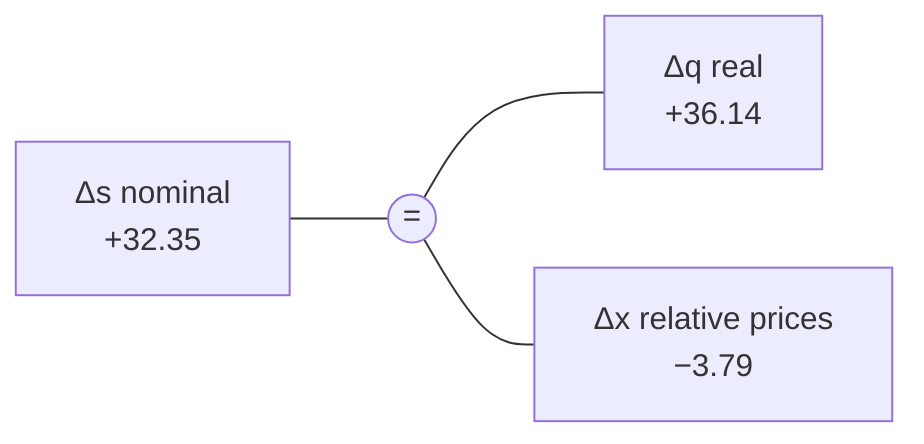

# Cheatsheet · Exchange rates, inflation, PPP and real depreciation

Quote conventions, log arithmetic, the real exchange rate and its decomposition, with
KAGURA's own numbers. Deeper: <a href="../../textbook/exchange-rates-logs-real-depreciation/">chapter 1</a>.

## Quotes and direction

| You see | It means |
|---|---|
| USD/JPY = 159.16 | 1 dollar costs 159.16 yen (price **of the dollar**) |
| USD/JPY ↑ | dollar stronger, **yen weaker** (yen depreciates) |
| JPY/USD = 1/159.16 | price of the yen in dollars |
| \(q\) ↑ | **real** yen depreciation: Japanese goods cheaper for dollar holders |

## Log arithmetic

| Formula | Use |
|---|---|
| \(s = 100\ln S\) | log level (log-points); the level itself is meaningless |
| \(\Delta s = 100\ln(S_1/S_0)\) | change in log-points |
| \(r = e^{\Delta s/100} - 1\) | back to a proportional change |
| \(\Delta s \approx 100r\) for small \(r\) | why daily changes ≈ % |
| \(\ln(ab) = \ln a + \ln b\) | log changes **add** over time and across factors |

| % change | 1 | 5 | 10 | 38.2 | 100 |
|---|---:|---:|---:|---:|---:|
| log-points | 0.995 | 4.88 | 9.53 | 32.35 | 69.31 |

## The real exchange rate

$$
Q = \frac{S\,P^{US}}{P^{JP}}, \qquad q = s - x, \qquad x = 100\ln\frac{P^{JP}}{P^{US}}, \qquad \boxed{\Delta s = \Delta q + \Delta x}
$$

**Recipe** (any two dates):

1. \(\Delta s = 100\ln(S_1/S_0)\)
2. \(\Delta x = 100\ln(P^{JP}_1/P^{JP}_0) - 100\ln(P^{US}_1/P^{US}_0)\)
3. \(\Delta q = \Delta s - \Delta x\)
4. Convert to %: \(e^{\Delta q/100} - 1\)

## KAGURA numbers (verified, frozen vintage)

| Span | USD/JPY | Δs | Δx | Δq | Real % |
|---|---|---:|---:|---:|---:|
| 2021-12 → 2026-07 | 115.17 → 159.16 | +32.35 | −3.79 | **+36.14** | +43.5 % |
| 1981-01 → 2026-07 | 206.70 → 159.16 | −26.1 | −92.5 | **+66.4** | +94 % |

- CPI 2021-12 → 2026-07: Japan 105.539 → 120.413 (+13.19 lp), US 280.845 → 332.813 (+16.98 lp).
- Weakest real yen in 1981–2026: **June 2026**. USD/JPY extremes: max 277.1 (1982-10), min 76.34 (2012-01).
- 55-month real move of +36.1 vs pre-2022 55-month moves: 95th percentile 34.8, maximum 47.4.
  **Large, not unprecedented.**

Decomposition, 2021-12 → 2026-07

Source: KAGURA frozen vintage (kagura.longrun.load_monthly); matches notebook 03.

## PPP in one table

| Version | Says | Testable implication | KAGURA |
|---|---|---|---|
| Absolute | \(Q = 1\) | levels equal | not meaningful with CPI indices |
| Relative / long-run | \(q\) mean-reverts | \(q\) is I(0); \(\theta = 1\) in \(s\) on \(x\) | \(q\) I(1) 1981–2021 (ambiguous from 1990); ARDL \(\hat\theta\) = −0.30, FM/D-OLS ≈ 0.8 |
| Imposed | \(\theta = 1\) by construction | model \(q\) directly | specification (b): not defensible (F 1.88, t −0.98) |

## Interest rates and the yen

| Concept | One line | KAGURA |
|---|---|---|
| Differential \(d\) | US yield − JGB yield, pp | 2Y primary, 10Y robustness |
| Carry | borrow yen, hold dollars, earn \(d\) if FX holds | background only |
| UIP | high-yield currency *expected* to depreciate by \(d\) | not tested; often fails empirically |
| Real differential \(r\) | \(d\) − (US − JP 12-month inflation) | realised-inflation proxy, ADR 0008 §9.1 |

## Watch out

- **Don't add percentages.** +38.2 % ≠ +43.5 % − 3.7 %. Add log-points.
- **32 log-points ≠ 32 %.**
- **Index levels are arbitrary.** \(x = -9.2\) in 1981 means nothing; only changes do.
- **Tax steps** (1989-04, 1997-04, 2014-04, 2019-10) shift Japanese CPI; check with tax-adjusted \(x\).
- **Never "undervalued" / "fair value"** without a defensible model (ADR 0008 §7.2). KAGURA has none.

## Go deeper

[Chapter 1](../textbook/exchange-rates-logs-real-depreciation.md) ·
[Concepts: PPP](../concepts/economics.md#purchasing-power-parity-nominal-vs-real-exchange-rate) ·
[Concepts: differential](../concepts/economics.md#interest-rate-differential-and-carry) ·
[Concepts: tax steps](../concepts/economics.md#consumption-tax-steps-in-japanese-cpi) ·
[H1b report](../reports/02-h1b-long-run-fundamentals.md)
