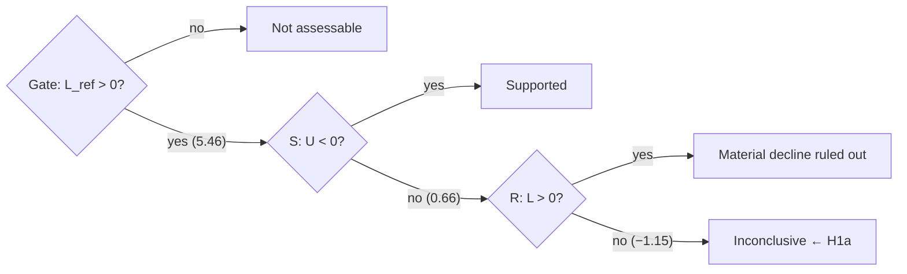

# Cheatsheet · Statistical inference, confidence intervals and hypothesis testing

From standard error to verdict, using H1a's numbers. Deeper:
<a href="../../textbook/regression-coefficients/">chapter 2</a> (regression) and
<a href="../../textbook/hypothesis-testing-uncertainty/">chapter 4</a> (testing).

## Regression essentials

| Quantity | Formula | Read as |
|---|---|---|
| Slope | \(\hat\beta = \operatorname{Cov}(x,y)/\operatorname{Var}(x) = \rho\,\operatorname{sd}(y)/\operatorname{sd}(x)\) | units of y per unit of x |
| Intercept | \(\hat\alpha = \bar y - \hat\beta\bar x\) | line passes through the means |
| R² | \(\rho^2 = \hat\beta^2\operatorname{Var}(x)/\operatorname{Var}(y)\) | share of variance; **descriptive** |
| Classical se | \(\sigma/\sqrt{\sum(x_i-\bar x)^2}\) | needs constant variance, no autocorrelation |
| HAC lag (ADR 0006) | \(L = \lfloor 4(T/100)^{2/9}\rfloor\) | T = 10,279 → L = 11 |

**H1a in one line:** \(\Delta s_t = \sum_e \mathbb 1[t\in e](\alpha_e + \beta_e\Delta d_t) + \varepsilon_t\), β in % per pp, HAC se.

## Normal-distribution numbers to know

| \(z\) | \(\Phi(z)\) | Use |
|---|---|---|
| −1.96 / 1.96 | 0.025 / 0.975 | 95 % two-sided; 2.5 % one-sided (\(c\) = 1.959964) |
| −1.645 / 1.645 | 0.05 / 0.95 | 5 % one-sided |
| 0 | 0.5 | |

## Intervals and tests

| Object | Formula | H1a example |
|---|---|---|
| 95 % CI | \(\hat\beta \pm 1.96\,\operatorname{se}\) | β_ref 6.44 ± 1.96(0.504) = [5.46, 7.43] |
| one-sided 97.5 % lower bound | \(L = \hat\theta - c\,\operatorname{se}\) | gate: \(L_{\text{ref}}\) = 5.46 > 0 ✓ |
| one-sided 97.5 % upper bound | \(U = \hat\theta + c\,\operatorname{se}\) | S: \(U\) = 0.66, not < 0 |
| z | \(\hat\theta/\operatorname{se}\) | δ: −0.2418 / 0.4615 = −0.52 |
| linear combination variance | \(a^2V_1 + b^2V_2 + 2ab\,C\) | \(0.3164^2 + \tfrac49 0.504^2\) ≈ \(0.4615^2\) |
| Fieller (ratio) | quadratic in ρ | relative change −37 %, [−49 %, −22 %] |
| Wald | \((R\hat\beta)'[R\hat VR']^{-1}(R\hat\beta) \sim \chi^2(q)\) | era equality: 239, q = 4 |

**Equivalences** (one-sided, α = 0.025): \(p_S < 0.025 \Leftrightarrow z < -c \Leftrightarrow U < 0\);
\(p_R < 0.025 \Leftrightarrow z > c \Leftrightarrow L > 0\).

## The H1a decision rule

$$
\delta = \beta_{\text{new}} - \tfrac23\,\beta_{\text{ref}} \qquad(\delta < 0 \iff \text{decline of at least one third})
$$

δ at three thresholds (only ⅓ is the test)

Source: notebook 02. ¼ and ½ are pre-registered sensitivity checks (ADR 0006 §5.2).

## Errors, size and power

|  | H0 true | H0 false |
|---|---|---|
| **Reject** | type I error (rate = size α) | correct (rate = power) |
| **Don't reject** | correct | type II error |

- **Monte Carlo size check:** simulate under H0, rejection share \(\hat p\), MC se \(\sqrt{\hat p(1-\hat p)/R}\).
  R = 4,000, p = 0.025 → se 0.0025. Andrews–Kim: 0.047–0.107 → **rejected**.
- **Bonferroni:** \(P(\cup A_k) \le \sum P(A_k)\). H1 family 0.05 = 0.025 (H1a) + 0.025 (H1b, unused).

## Say this, not that

| ✗ Don't say | ✓ Say |
|---|---|
| "p = 0.30, so a 30 % chance there was no material decline" | "If δ were 0, a z this low or lower would occur 30 % of the time" |
| "Not significant, so the link is stable" | "Inconclusive: a decline above or below one third can't be distinguished" |
| "95 % chance β is in [5.46, 7.43]" | "This procedure covers the true β in 95 % of samples" |
| "R² rose, so the link strengthened" | "R² rose because the differential moved more" |
| "Rates drive the yen" | "A wider differential is associated with a weaker yen" |
| "Exploratory p = 0.03 supports H1b" | "Exploratory, descriptive; no error-rate guarantee (ADR 0008 §7.1)" |

## Go deeper

[Chapter 2](../textbook/regression-coefficients.md) · [Chapter 4](../textbook/hypothesis-testing-uncertainty.md) ·
[Concepts: inference](../concepts/inference.md) · [H1a report](../reports/01-h1a-short-run-comovement.md) ·
[ADR 0006 §5](../../decisions/0006-h1-formal-testing-protocol.md)
