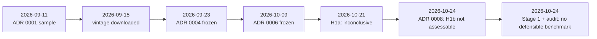

# Cheatsheet · KAGURA research results, methodological decisions and limitations

Everything you need to state, and defend, what KAGURA has and has not found as of
2026-10-25. Every number is from an executed notebook or a frozen ADR.

## The question

> Has USD/JPY structurally decoupled from the US–Japan interest-rate differential, and if so, when
> and by how much?

| | H1a · short run | H1b · long run |
|---|---|---|
| Asks | do daily *changes* still co-move as in 2013–21? | do *levels* share an equilibrium that broke after 2022? |
| Protocol | [ADR 0006](../../decisions/0006-h1-formal-testing-protocol.md), frozen 2026-10-09 | [ADR 0008](../../decisions/0008-h1b-long-run-protocol.md), frozen 2026-10-24 |
| α | 0.025 one-sided | 0.025, **unused** |
| Verdict | **inconclusive** | **not assessable**; exploratory: **no defensible benchmark** |
| Report | [H1a](../reports/01-h1a-short-run-comovement.md) | [H1b](../reports/02-h1b-long-run-fundamentals.md) |

## H1a numbers (notebook 02, commit `2c5b446`)

| Quantity | Value |
|---|---|
| β 2013–21 (ref) | **6.44** % per pp, se 0.50, 95 % [5.46, 7.43] |
| β 2022– (new) | **4.05**, se 0.32, 95 % [3.43, 4.67] |
| β other eras | 0.67 (1981–89), −0.14 (1990–98), 2.68 (1999–2012) |
| Absolute change | −2.39 [−3.56, −1.22] |
| Relative change | −37 %, Fieller [−49 %, −22 %] |
| δ = β_new − ⅔β_ref | −0.24 [−1.15, 0.66]; p_S 0.30, p_R 0.70 |
| Gate | L_ref = 5.46, p ≈ 10⁻³⁸: passes |
| R² | 0.133 → 0.191 |
| Era equality (secondary) | Wald χ²(4) = 239, p ≈ 10⁻⁵⁰ |
| Rows | 10,279 used (2,007 ref, 1,045 new); 1,187 excluded; HAC lag 11 |

| Robustness | β_ref → β_new | Category |
|---|---|---|
| R1 lagged US leg | 1.43 → 0.75 | inconclusive |
| R2 monthly | 4.38 → 7.45 | ruled out |
| R3 10Y | 4.99 → 4.20 | ruled out |

Label: **"sensitive to R2 (ruled out), R3 (ruled out)"**. Sensitivity thresholds: decline ≥ ½ ruled
out; ≥ ¼ inconclusive.

## H1b numbers (ADR 0008; notebooks 03–04)

| Item | Value |
|---|---|
| Andrews–Kim size at nominal 0.025 | 0.047–0.107; P(p ≤ 1/438) = 0.035–0.087 → **rejected** |
| Wagner–Wied | theory excludes drifting x / I(0) d; size 0.02–0.90 by bandwidth; power 0.02–0.08 → **rejected** |
| Real depreciation 2021-12 → 2026-07 | Δs +32.4 = Δq +36.1 + Δx −3.8 |
| Integration, 1981–2021 | all I(1); q, d2 ambiguous from 1990 |
| Bounds tests (F, t) | (a) 4.08, −1.87 · (b) 1.88, −0.98 · (c) 3.51, −2.98 · (d) 3.97, −1.88 |
| Classification | all four **not defensible** (unchanged in the audit's sensitivity variant) |
| Half-lives | 26–144 months, descriptive only |

## Decision log at a glance

| ADR | Decision | Why it matters |
|---|---|---|
| [0001](../../decisions/0001-sample-period.md) | model from 1981-01 (capital liberalisation) | includes Plaza → YCC; 1980s distorted by intervention |
| [0002](../../decisions/0002-data-sources.md) | official sources; FRED, MOF, BIS | provenance; current vintages, not real-time |
| [0003](../../decisions/0003-time-alignment.md) | USD/JPY calendar; as-of joins; conservative release lags | no look-ahead; timing variants |
| [0004](../../decisions/0004-h1-exploratory-specification.md) | windows, eras, events, exclusion rule frozen before plots | stops tuning to the picture |
| [0005](../../decisions/0005-carried-share-guard.md) | carried-share cap 8 % | caught a FRED source losing history |
| [0006](../../decisions/0006-h1-formal-testing-protocol.md) | H1a: δ test, ⅓ threshold, gate/S/R, Bonferroni | the confirmatory test |
| [0008](../../decisions/0008-h1b-long-run-protocol.md) | H1b not assessable; method search closed; exploratory plan; "fair value" banned | honest null; no specification search |

## Allowed and banned statements

| ✓ Allowed | ✗ Not allowed |
|---|---|
| "The daily 2Y slope fell from 6.44 to 4.05; whether by more than a third is inconclusive." | "The yen has decoupled from rates." |
| "A material decline is ruled out at the monthly horizon and for 10Y yields." | "The relationship is stable." |
| "H1b's confirmatory claim is not assessable with the methods evaluated." | "There is no evidence of long-run decoupling." / "…evidence of decoupling." |
| "The 2022–26 depreciation was real, not from relative prices." | "The yen is undervalued / below fair value." |
| "A wider differential is associated with a weaker yen." | "Higher US rates drove the yen down." |
| "Simulated pilots show the methods fail at this design." | "USD/JPY residuals are too persistent to test." |

(ADR 0008 §7 and §7.2; ADR 0006 §5.1.)

## Limitations to volunteer

1. **Break date.** 2022-01 is a candidate, not an estimated break; a later break biases H1a toward no change.
2. **Timing.** Same-day β includes post-fix US news; era comparison assumes stable timing distortion (A5).
3. **Not blind.** Approximate slopes were visible before H1a (ADR 0006 §1.1).
4. **Data.** Current-vintage CPI; fixed release rules; Japan policy rate from 1985, 10Y JGB from 1986; US CPI 2025-10 missing.
5. **Power.** Bounds tests and unit-root tests are weak with persistent deviations; "not found" ≠ "absent".
6. **Association only.** No design isolates causal effects.

## What comes next

- **Stage 2** (plan under review, nothing run): exploratory dating of breaks in the H1a relationship and
  comparison with BOJ, Fed and MOF event dates.
- **Mechanisms** (H2–H7): hedging, flows, intervention, risk. See the [roadmap](../../ROADMAP.md).

## Go deeper

[Overview report](../reports/00-research-overview.md) · [Case study](../journal/h1b-methodological-journey.md) ·
[Chapter 4](../textbook/hypothesis-testing-uncertainty.md) · [Concepts: methodology](../concepts/methodology.md)
