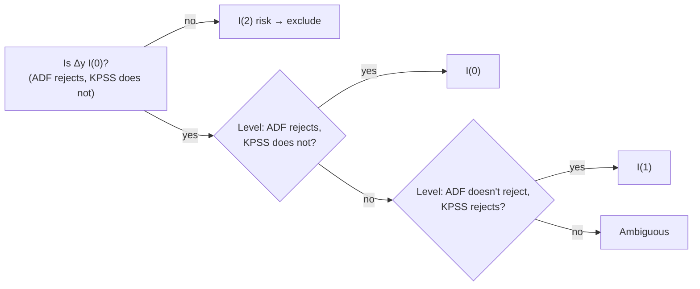

# Cheatsheet · Time-series econometrics, stationarity and cointegration

How to classify a series, when a levels regression is meaningful, and how to read
H1b's bounds tests. Deeper: <a href="../../textbook/stationarity-unit-roots/">chapter 3</a>.

## Processes at a glance

| Process | Equation | Mean | Variance | Shock effect after h | Order |
|---|---|---|---|---|---|
| White noise | \(\varepsilon_t\) | 0 | \(\sigma^2\) | 0 | I(0) |
| AR(1), \(\lvert\phi\rvert<1\) | \(c + \phi y_{t-1} + \varepsilon_t\) | \(c/(1-\phi)\) | \(\sigma^2/(1-\phi^2)\) | \(\phi^h\) | I(0) |
| Random walk | \(y_{t-1} + \varepsilon_t\) | \(y_0\) | \(t\sigma^2\) (grows) | 1 (permanent) | I(1) |
| RW with drift | \(\mu + y_{t-1} + \varepsilon_t\) | \(y_0 + \mu t\) | \(t\sigma^2\) | 1 | I(1) |

- **Half-life:** \(h = \ln 0.5/\ln\phi\). φ = 0.9 → 6.6; 0.95 → 13.5; 0.98 → 34.3; 0.99 → 69.0 periods.
- **Differencing:** I(d) series → difference d times → I(0). \(\Delta(100\ln S)\) = log return.

## Unit-root tests

| Test | Regression / model | H0 | Small p means |
|---|---|---|---|
| ADF | \(\Delta y_t = c\,[+\delta t] + \gamma y_{t-1} + \sum a_i\Delta y_{t-i} + e_t\) | \(\gamma = 0\): unit root | looks stationary |
| KPSS | \(y_t = \xi t + r_t + u_t,\ r_t\) a random walk | \(\operatorname{Var}(\Delta r) = 0\): stationary | looks non-stationary |

ADF 5 % critical value with constant ≈ **−2.86** (Dickey–Fuller, not normal). KAGURA: AIC lags ≤ 12;
trend for x, x_tax, q in levels.

### Classification rule (ADR 0008 §9.2; `kagura.longrun.classify`)

### KAGURA results

| Series | 1981–2021 | 1990–2021 | incl. 2022–26 |
|---|---|---|---|
| s, x, x_tax | I(1) | I(1) | I(1) |
| q | I(1) | ambiguous | I(1) |
| d2 | I(1) | ambiguous | ambiguous |
| d10 | I(1) | I(1) | ambiguous |
| r | I(1) | I(1) | I(0) |

No I(2) risk (all Δ-series I(0); largest AR root of Δx 0.88). Read "I(1)" as "mean reversion not
established", not "proven random walk".

## Which regression is allowed?

| Situation | Levels OLS | Changes OLS | ARDL bounds | FM-OLS / D-OLS |
|---|---|---|---|---|
| All I(0) | ✓ | ✓ | ✓ | ✗ |
| All I(1), not cointegrated | ✗ **spurious** | ✓ | ✓ (finds none) | ✗ |
| All I(1), cointegrated | consistent, non-standard inference | misses error correction | ✓ | ✓ |
| Mix of I(0) and I(1) | ✗ unbalanced | ✓ | ✓ | I(1) block only |
| Any I(2) | ✗ | ✗ | ✗ | ✗ |

## Cointegration and error correction

$$
s_t = c + \theta x_t + \gamma d_t + u_t\ (u_t \sim I(0)) \qquad
\Delta s_t = \phi\,u_{t-1} + \dots,\ \ \phi < 0
$$

| Coefficient | Theory expects | KAGURA (a), ARDL | KAGURA (a), FM-OLS |
|---|---|---|---|
| θ (relative prices) | 1 (PPP) | −0.30 (se 0.73) | 0.82 (se 0.24) |
| γ (2Y differential) | > 0 | 16.0 (se 11.1) | −0.06 (se 3.08) |
| φ (adjustment / month) | < 0, clearly | −0.014 | — |

## Reading the ARDL bounds test {#reading-the-ardl-bounds-test}

$$
\Delta y_t = c + \phi y_{t-1} + \pi'X_{t-1} + \textstyle\sum a_i\Delta y_{t-i} + \sum b_j'\Delta X_{t-j} + u_t
$$

| F (tests φ = π = 0) | t (tests φ = 0) | Reading |
|---|---|---|
| > I(1) bound | < I(1) bound (more negative) | levels relation indicated |
| between bounds | between bounds | inconclusive |
| < I(0) bound | > I(0) bound | no relation |

PSS Case III, 5 %: k = 2: F **3.79 / 4.85**, t **−2.86 / −3.53**; k = 1: F 4.94 / 5.73, t −2.86 / −3.22.
Lag selection pushes effective bounds outward. Simulated full-procedure 95 % quantiles: F 4.93–5.82.

| Spec | F | t | Verdict |
|---|---|---|---|
| (a) s on x, d2 | 4.08 (inconclusive band) | −1.87 (inside I(0)) | not defensible |
| (b) q on d2 | 1.88 | −0.98 | not defensible |
| (c) s on x, d10 | 3.51 | −2.98 (inconclusive band) | not defensible, closest to fragile |
| (d) s on x_tax, d2 | 3.97 | −1.88 | not defensible |

## Status of each method in KAGURA

| Method | Status | Why |
|---|---|---|
| ADF / KPSS | exploratory, run | ADR 0004, 0008 §9.2 |
| ARDL bounds, FM-OLS, D-OLS | exploratory, run | Stage 1: no defensible baseline |
| Half-life + block bootstrap | point estimates only | bootstrap can't represent a unit root |
| Andrews–Kim | **rejected** | size 0.047–0.107; 2.5 % unattainable |
| Wagner–Wied | **rejected** | theory excludes drifting x, I(0) d; power 0.02–0.08 |
| Bai–Perron / sup-Wald | **planned** | ADR 0006 §6.2; Stage 2 under review |

## Watch out

- Non-rejection by ADF is weak evidence; breaks mimic unit roots.
- Each transformed series (q, x_tax) needs its own classification.
- A finite bootstrap half-life interval is not evidence of mean reversion here.
- Simulated pilot results concern synthetic data, not USD/JPY.

## Go deeper

[Chapter 3](../textbook/stationarity-unit-roots.md) · [Concepts: time series](../concepts/time-series.md) ·
[H1b report](../reports/02-h1b-long-run-fundamentals.md) · [Case study](../journal/h1b-methodological-journey.md) ·
[ADR 0008](../../decisions/0008-h1b-long-run-protocol.md)
