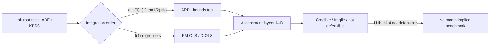

# Time-series econometrics concepts

The tools for asking whether levels of wandering series share a long-run
anchor, and the reasons KAGURA's answer for H1b was "not assessable" and then "not defensible".
This page separates what was <em>run</em> (exploratory, on real data), what was
<em>investigated and rejected</em> (on synthetic data), and what is only <em>planned</em>.

Status labels:
Implemented
Exploratory
Rejected
Planned
Background.
See the [concept index](../INDEX.md#concept-index).

---

## Stationarity, unit roots and integration order; ADF and KPSS {#stationarity-and-unit-roots}

Exploratory Level I · ADR 0004; ADR 0008 §9.2

**Plain English.** A stationary series fluctuates around a fixed mean with stable variance. A series
with a unit root wanders: shocks never fade. I(1) means "becomes stationary after one difference".
ADF tests the null of a unit root; KPSS tests the null of stationarity.

**Why it exists.** Ordinary regression inference assumes stationary errors. With I(1) series it
breaks down unless they are cointegrated.

**Definition.** ADF regression and hypotheses:

$$
\Delta y_t = c + [\delta t] + \gamma y_{t-1} + \sum_{i=1}^{p} a_i \Delta y_{t-i} + e_t, \qquad H_0: \gamma = 0 \ (\text{unit root}) .
$$

\(\gamma = \phi - 1\) from an AR(1); the t-ratio has the non-standard Dickey–Fuller distribution
(5 % critical value with constant ≈ −2.86).

**How KAGURA used it.** ADF (AIC lags ≤ 12, MacKinnon p) and KPSS on levels and differences.
ADR 0008's rule: **I(2) risk** if the difference is not I(0); **I(0)** if level ADF rejects and KPSS does
not; **I(1)** if level ADF does not reject and KPSS rejects; otherwise **ambiguous**
(`kagura.longrun.classify`).

**What we found.** Over 1981–2021, s, q, x, tax-adjusted x, d2, d10 and r were all I(1), with no I(2)
risk. From 1990, q and d2 became ambiguous. In notebook 01 (full sample) the 10Y differential's
level was inconclusive (ADF p = 0.047, KPSS p = 0.019).

**Assumptions and limits.** Low power near a unit root; mean shifts mimic unit roots (Perron 1989);
sample-dependent. 5 % is descriptive.

**Common mistake.** "ADF did not reject, so it is a random walk."

**Go deeper.** [Chapter 3](../textbook/stationarity-unit-roots.md) ·
[Time-series cheatsheet](../cheatsheets/time-series.md) · [H1b report §3](../reports/02-h1b-long-run-fundamentals.md#integration-order) ·
[`longrun.py`](https://github.com/akiblasco/kagura/blob/main/src/kagura/longrun.py)

---

## Spurious regression

Background (motivates design) Level I · notebook 01 §6; ADR 0006

**Plain English.** Regressing one random walk on another, unrelated one tends to produce a large R²
and "significant" t-statistics that mean nothing.

**Why it exists.** It is the reason levels regressions of non-stationary series need special methods.

**Definition.** If \(y_t\) and \(x_t\) are independent I(1) processes, the OLS t-statistic on \(x\) in
\(y_t = a + bx_t + u_t\) diverges as \(T\) grows (Phillips 1986), so \(\lvert t\rvert > 1.96\) occurs far
more often than 5 % of the time.

**How KAGURA used it.** As a design constraint: notebook 01 concluded that "changes are the safe
baseline; any levels analysis needs a cointegration framework that allows for breaks". H1a uses
changes; H1b uses cointegration methods.

**What we found.** Not estimated; see the [simulation in chapter 3](../textbook/stationarity-unit-roots.md#7-spurious-regression).

**Assumptions and limits.** The problem disappears if the series are cointegrated.

**Common mistake.** Trusting a high R² from a levels regression of two trending series.

**Go deeper.** [Chapter 3 §7](../textbook/stationarity-unit-roots.md#7-spurious-regression)

---

## Cointegration and error correction {#cointegration-and-error-correction}

Exploratory (sought, not found) Level A · H1b (ADR 0008)

**Plain English.** Two or more I(1) series are cointegrated if some combination of them is
stationary: they wander, but together, tied by a long-run relation. When they drift apart, an
**error-correction** mechanism pulls them back.

**Why it exists.** It is the only setting in which a regression in levels of I(1) series is
meaningful, and it would allow a "model-implied benchmark" for USD/JPY.

**Definition.** Long-run relation and error-correction form:

$$
s_t = c + \theta x_t + \gamma d_t + u_t,\ u_t \sim I(0); \qquad
\Delta s_t = \phi\,\hat u_{t-1} + \text{short-run terms} + \varepsilon_t,\ \phi < 0 .
$$

\(\theta\): PPP coefficient (1 under PPP); \(\gamma\): long-run differential coefficient (expected > 0);
\(\phi\): adjustment speed (fraction of the gap closed per month).

**How KAGURA used it.** H1b's intended confirmatory claim was that this relation held over 1981–2021
and broke after 2022 (ADR 0008 §2). That test was not assessable. Stage 1 then explored four
specifications with three estimators.

**What we found.** No specification is defensible. In (a), \(\phi = -0.014\) per month, t = −1.87 (inside
the I(0) bound), \(\hat\theta = -0.30\) (wrong sign), \(\hat\gamma = 16.0\) (HAC se 11.1).

**Assumptions and limits.** Bounds tests have low power with persistent deviations, so "not found" is
not "does not exist". Breaks (e.g. Plaza) could hide sub-period relations.

**Common mistake.** Calling a fitted levels combination a "fair value". ADR 0008 §7.2 bans this.

**Go deeper.** [H1b report](../reports/02-h1b-long-run-fundamentals.md) ·
[Time-series cheatsheet](../cheatsheets/time-series.md) · [Chapter 3 §11](../textbook/stationarity-unit-roots.md#11-differencing-what-it-buys-and-what-it-costs)

---

## ARDL and the Pesaran–Shin–Smith bounds test

Exploratory Level A · ADR 0008 §9.4; notebooks 03–04

**Plain English.** A test of whether a levels relation exists that works whether the regressors are
I(0), I(1) or a mix. Because the critical values depend on that unknown mix, it gives two bounds: a
statistic beyond the I(1) bound indicates a relation, one inside the I(0) bound indicates none, and
anything between is inconclusive.

**Why it exists.** KAGURA's differential has uncertain integration order, which rules out tests that
need all variables I(1).

**Definition.** Unrestricted error-correction model (Case III: unrestricted constant, no trend):

$$
\Delta y_t = c + \phi y_{t-1} + \pi' X_{t-1} + \sum_{i=1}^{p-1} a_i \Delta y_{t-i} + \sum_{j=0}^{q-1} b_j'\Delta X_{t-j} + u_t .
$$

F tests \(\phi = \pi = 0\) jointly; t tests \(\phi = 0\). Long-run coefficients are \(-\pi/\phi\). PSS 5 %
bounds (k = 2): F 3.79 / 4.85, t −2.86 / −3.53.

**How KAGURA used it.** `kagura.longrun.fit_ardl` and `select_ardl` (lags by BG-filtered AIC, ≤ 12).
Statistics were compared both with PSS asymptotic bounds and with simulated 95 % quantiles of the
*full* selection procedure. Long-run forcing of x and d was checked via loadings (ADR 0008 §9.3).

**What we found.**

| Spec | F | t | Simulated F 95 % / t 5 % |
|---|---|---|---|
| (a) s on x, d2 | 4.08 | −1.87 | 4.93 / −3.54 |
| (b) q on d2 | 1.88 | −0.98 | 5.82 / −3.25 |
| (c) s on x, d10 | 3.51 | −2.98 | 4.99 / −3.63 |
| (d) s on x_tax, d2 | 3.97 | −1.88 | 4.93 / −3.54 |

No statistic crosses an I(1) bound; the audit's sensitivity variant changed no classification. No
long-run-forcing loading was clearly non-zero (largest |t| = 1.61).

**Assumptions and limits.** Assumes x and d are long-run forcing (PSS Assumption 3). Lag selection
widens the effective bounds (full-procedure 97.5 % quantiles F 5.49–6.04, ADR 0008 §8.3). Low power
near a unit root.

**Common mistake.** Reading an F in the inconclusive band (like (a)'s 4.08) as weak support. With
t inside the I(0) bound, there is no error-correction support.

**Go deeper.** [H1b report §3](../reports/02-h1b-long-run-fundamentals.md#the-bounds-test-four-candidate-relationships) ·
[Time-series cheatsheet](../cheatsheets/time-series.md#reading-the-ardl-bounds-test)

---

## Lag selection: AIC and Breusch–Godfrey filtering

Exploratory Level I · ADR 0008 §9.4; ADR 0004

**Plain English.** Choose how many lags a model includes by trading fit against complexity (AIC), but
only among models whose residuals show no leftover serial correlation (Breusch–Godfrey test).

**Why it exists.** Too few lags leave autocorrelated errors and invalid tests; too many waste degrees
of freedom.

**Definition.** \(\text{AIC} = n\ln(\text{RSS}/n) + 2k\) (\(k\) parameters). BG(12): regress residuals on
regressors and 12 lagged residuals; LM = \(nR^2 \sim \chi^2(12)\). Rule: the lowest-AIC order with BG
p > 0.05; if none passes, the overall AIC minimum, flagged.

**How KAGURA used it.** `kagura.longrun.select_ardl` (p, q ≤ 12) and `bg_pvalue`. ADF lags by AIC ≤ 12.

**What we found.** Orders selected: (a), (c), (d) p = 12, q = 1; (b) p = 3, q = 2. All passed BG. In
the audit's sensitivity variant (1,728 models with independent lags), (a) passed BG only at
p = 0.051.

**Assumptions and limits.** Selection is part of the procedure, so critical values should account for
it, which is why KAGURA simulated the full procedure.

**Common mistake.** Using asymptotic critical values after data-driven lag selection.

**Go deeper.** [H1b report §4](../reports/02-h1b-long-run-fundamentals.md#4-the-specification-audit)

---

## FM-OLS and D-OLS

Exploratory Level A · ADR 0008 §9.3–§9.4

**Plain English.** Two ways to estimate a cointegrating relation that correct OLS's small-sample bias
and give usable standard errors: FM-OLS adjusts after estimation for serial correlation and
feedback; D-OLS adds leads and lags of the regressors' changes.

**Why it exists.** Static OLS is consistent under cointegration but biased in finite samples, with
non-standard distributions.

**Definition.** D-OLS (Stock–Watson):
\(y_t = c + \beta'X_t + \sum_{j=-k}^{k}\lambda_j'\Delta X_{t-j} + e_t\), with \(k \le 6\) by BIC. FM-OLS
(Phillips–Hansen): OLS with long-run-variance corrections (Bartlett kernel, Andrews bandwidth).

**How KAGURA used it.** `kagura.longrun.fmols`, `dols`, on I(1) regressors only (§9.3). Intervals are
"approximate" when x enters, because x drifts and the limit theory assumes driftless regressors.

**What we found.** They disagree with the ARDL. (a): FM-OLS θ = 0.82 (se 0.24), γ = −0.06 (se 3.08);
D-OLS θ = 0.81, γ = 0.66 (se 3.39); ARDL θ = −0.30, γ = 16.0. Estimator disagreement is itself a
reason for "not defensible".

**Assumptions and limits.** Require cointegration, which was not established. That makes their
estimates descriptive at best.

**Common mistake.** Reporting the estimator whose θ looks most like PPP.

**Go deeper.** [H1b report §3](../reports/02-h1b-long-run-fundamentals.md#the-bounds-test-four-candidate-relationships)

---

## Half-life of deviations, and why its bootstrap failed here {#half-life}

Exploratory (point estimates only; bootstrap intervals rejected) Level A · ADR 0008 §9.4; notebooks 03–04

**Plain English.** How many months until half of a deviation from the long-run relation has
disappeared.

**Why it exists.** It translates an adjustment speed into an intuitive time scale; ADR 0008 used
"interval finite, upper end under 10 years" as a screening benchmark.

**Definition.** For an AR(1) with coefficient \(\rho\): \(h = \ln 0.5/\ln\rho\). KAGURA uses the first
horizon at which the model's impulse response falls to 0.5 (`kagura.longrun.half_life`), with a
90 % moving-block bootstrap (block 24, 999 draws, `bootstrap_half_life`).

**What we found.** Point estimates (notebook 03): (a) 55, (b) 99, (c) 26, (d) 56 months; the report
cites 26–144 across the original and sensitivity runs. The bootstrap intervals were **not used as
evidence**: they rebuild data from the fitted, stable ARDL, so they cannot represent a unit root and
are too narrow near one (notebooks 03–04).

**Assumptions and limits.** Near \(\rho = 1\), half-lives are weakly identified: \(\rho\) = 0.98 gives
34 months, \(\rho\) = 0.99 gives 69.

**Common mistake.** Reporting a finite bootstrap interval as evidence of mean reversion.

**Go deeper.** [Chapter 3 §3.4](../textbook/stationarity-unit-roots.md#34-half-life) ·
[H1b report §5](../reports/02-h1b-long-run-fundamentals.md#5-what-this-does-and-does-not-establish)

---

## Andrews–Kim end-of-sample cointegration-breakdown test

Rejected Level A · ADR 0008 §4 (synthetic data only)

**Plain English.** A test for whether a cointegrating relation broke down in the last *m*
observations. It compares the end-window residuals with all same-length windows earlier in the
sample (subsampling).

**Why it exists.** It was designed for exactly H1b's question: a relation over T periods, a short
window at the end.

**Definition.** The P statistic sums squared residuals over the final window. Its p-value is its rank
among the \(T - m + 1\) earlier window sums (Andrews and Kim 2006, *JBES* 24(4), eqs. 3–15).

**How KAGURA used it.** Implemented and verified against the paper's Table 1, then pilot-simulated at
T = 492, m = 55, nominal 0.025.

**What we found.** Null rejection 0.047–0.107 in every main cell. With 438 subsample windows the smallest
p-value is 1/438, and P(p ≤ 1/438) under the null was already 0.035–0.087, so **no critical value gives
a 2.5 % test**. Cause: 438 overlapping windows carry only about T/m ≈ 9 independent pieces of information.

**Assumptions and limits.** A methodological finding on synthetic data, **not evidence about USD/JPY**.

**Common mistake.** Size-correcting the critical value. Here it is impossible, because the p-value
cannot go low enough.

**Go deeper.** [Case study](../journal/h1b-methodological-journey.md) ·
[H1b report §2](../reports/02-h1b-long-run-fundamentals.md#2-the-search-for-a-valid-confirmatory-test) ·
[ADR 0008 §4](../../decisions/0008-h1b-long-run-protocol.md)

---

## Wagner–Wied cointegration monitoring

Rejected Level A · ADR 0008 §5 (synthetic data only)

**Plain English.** A monitoring procedure that tracks the cumulated residuals of a cointegrating
regression after a calibration period and signals when they drift too far.

**Why it exists.** It is the other published approach to detecting a cointegration breakdown after a
known date.

**Definition.** A detector built from partial sums of FM-OLS (or IM-OLS) residuals over the monitoring
period, compared with simulated critical values (k = 2, 97.5 %).

**How KAGURA used it.** Source-verified (only the working-paper/package form reproduced the
published critical values; the journal equation did not; documented, not adjudicated) and
pilot-simulated.

**What we found.** **Decisive:** its theory assumes driftless random-walk regressors, but x drifts and d
may be stationary. **Corroborating:** size depended on the bandwidth rule (0.02 to 0.90), and power
against 1–2σ breaks at realistic persistence was 0.02–0.08.

**Assumptions and limits.** Synthetic-data findings, not evidence about USD/JPY.

**Common mistake.** Assuming simulation can rescue a method whose theory does not cover the design.
"Simulation measures the consequences of these violations. It cannot restore coverage" (ADR 0008 §5.2).

**Go deeper.** [Case study](../journal/h1b-methodological-journey.md) ·
[ADR 0008 §5](../../decisions/0008-h1b-long-run-protocol.md)

---

## Structural breaks: Bai–Perron, trimming, break-date intervals

Planned Level A · ADR 0006 §6.2; Stage 2 plan (under review)

**Plain English.** Methods that estimate *when* a regression's coefficients changed, how many
changes there were, and how precisely each date is known, instead of assuming a date like 2022-01.

**Why it exists.** H1a's 2022-01 boundary is a pre-specified candidate. If the true change came in 2023
or 2024, the "new" era mixes regimes and the contrast is biased toward no change (ADR 0006 A6).

**Definition.** For \(m\) breaks at dates \(T_1 < \dots < T_m\), estimate the dates by minimising the total
sum of squared residuals over all partitions. **Trimming** \(\varepsilon\) requires each segment to
contain at least \(\varepsilon T\) observations, so breaks near the sample ends cannot be detected.
sup-Wald statistics test for breaks; confidence intervals for break dates quantify uncertainty.

**How KAGURA used it.** Not yet. ADR 0006 §6.2 deferred unknown-break inference to a separate ADR and
records, as non-binding, Boldea, Cornea-Madeira and Hall's (2019) wild fixed-regressor bootstrap
with sup-Wald and 15 % trimming on a dynamic specification. The reason for deferral: that bootstrap
assumes martingale-difference errors, which the same-day timing makes doubtful. A Stage 2 plan is
under review; nothing has been estimated.

**What we found.** Nothing yet.

**Assumptions and limits.** Many policy regimes in 45 years (ADR 0001); trimming limits detection
near 2026.

**Common mistake.** Matching a break date to a policy event and calling it causal.

**Go deeper.** [ADR 0006 §6.2](../../decisions/0006-h1-formal-testing-protocol.md) ·
[Roadmap](../../ROADMAP.md)
