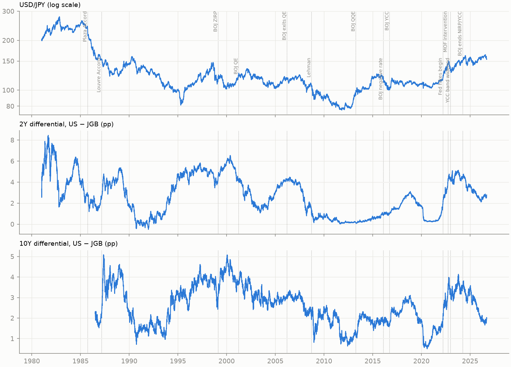

# Research overview — what KAGURA asks, and how it guards its answers

Has USD/JPY structurally decoupled from the US–Japan interest-rate differential,
and if so, when and by how much? Two confirmatory attempts so far: the short-run test is
<strong>inconclusive</strong>, and the long-run test could not be run validly at all.

Sample

1981–2026

Daily to 2026-09-11; monthly to 2026-08

Frozen vintage

2026-09-15

SHA-256 checksums in ADR 0006 §9.2

H1a · short run

Inconclusive

ADR 0006

H1b · long run

Not assessable

ADR 0008

???+ abstract "Concepts behind this page"
    [Observation, release and vintage dates](../concepts/data.md#observation-release-and-vintage-dates-look-ahead-bias) ·
    [frozen vintages and checksums](../concepts/data.md#frozen-data-vintages-and-checksums) ·
    [carried values and the exclusion rule](../concepts/data.md#carried-values-the-exclusion-rule-and-the-carried-share-guard) ·
    [confirmatory vs exploratory](../concepts/methodology.md#confirmatory-vs-exploratory-analysis) ·
    [pre-registration and outcome categories](../concepts/inference.md#pre-registration-gates-and-outcome-categories) ·
    [Bonferroni](../concepts/inference.md#multiple-testing-and-bonferroni) ·
    [association vs causation](../concepts/methodology.md#association-vs-causation).
    Summary: [KAGURA results cheatsheet](../cheatsheets/kagura-results.md).

## 1. Economic motivation

*Context, not a KAGURA result.*

For most of 1999–2024 Japan held its policy rate at or near zero, while US rates rose and
fell through several cycles. The yen has therefore often been read as a function of the
**US–Japan interest-rate differential**: when US yields rise relative to Japan's, holding
dollars pays more and USD/JPY tends to rise. The yen's slide from roughly 115 to around 160
per dollar after 2022 (figure below), during the Fed's tightening and the Bank of Japan's yield-curve
control, fits that reading.

But the period also brought Ministry of Finance intervention (2022, 2024), the end of
negative rates and yield-curve control in 2024, a return of Japanese inflation, and a large real depreciation. KAGURA asks whether rate differentials still
explain the yen as they used to, or whether the relationship has changed.

<figure markdown>

<figcaption>USD/JPY (log scale) and the 2Y and 10Y US–JGB yield differentials (pp), daily,
1981–2026. Dotted lines: ADR 0004 policy events. Source: reports/figures/01_levels.png
(notebook 01, exploratory).</figcaption>
</figure>

## 2. Two meanings of "decoupling"

| | H1a · short run | H1b · long run |
|---|---|---|
| Question | Do daily *changes* still move together as much as in 2013–2021? | Do the *levels* still share an equilibrium? |
| Data | daily, 1981–2026 | monthly, 1981–2026 |
| Method | era-interacted OLS with HAC errors | cointegration / ARDL bounds test |
| Protocol | [ADR 0006](../../decisions/0006-h1-formal-testing-protocol.md) | [ADR 0008](../../decisions/0008-h1b-long-run-protocol.md) |
| Outcome | [inconclusive](01-h1a-short-run-comovement.md) | [not assessable](02-h1b-long-run-fundamentals.md) |

The two share the H1 family error rate of 0.05, split equally by Bonferroni. H1b spent
none of its 0.025.

## 3. The data foundation

| Series | Source | Frequency |
|---|---|---|
| USD/JPY | FRED `DEXJPUS` (Fed H.10, noon New York) | daily |
| US 2Y, 10Y Treasury | FRED `DGS2`, `DGS10` | daily |
| Effective fed funds | FRED `DFF` | daily |
| JGB 2Y, 10Y | Japan Ministry of Finance | daily |
| Japan call rate | FRED (OECD) | monthly |
| US CPI | FRED `CPIAUCSL` (BLS) | monthly |
| Japan CPI | BIS long CPI series | monthly |

**Principles built into the pipeline**
([ADR 0001–0005](../../decisions/0001-sample-period.md)):

- **Time is handled explicitly.** Observation date, release date and vintage are kept
  apart. Macro data enter only after a conservative release lag, so no regression uses a
  number before it would have been known (ADR 0003).
- **No silent filling.** A change is used only between two live observations; carried
  values are flagged, and the share of carried values is guarded (ADR 0004, 0005).
- **Frozen vintages.** Before the first confirmatory model ran, the exact files were
  checksummed into ADR 0006. `make data` refuses to overwrite them, and the H1a notebook
  stops if a checksum differs. H1b added two CPI files under the same rule.

**Known limitations.** CPI values are current vintages, not real-time vintages; release
lags are fixed rules, not historical calendars; the Japan policy-rate series starts in
1985 and the 10Y JGB in 1986; several large one-day moves are flagged but not yet
checked against an independent source.

## 4. How KAGURA guards its conclusions

- **Decide before looking.** Each confirmatory test is specified and frozen in an ADR,
  pushed publicly, before it runs on real data. What had already been seen is disclosed
  (ADR 0006 §1.1).
- **Name the possible outcomes in advance.** "Supported", "ruled out", "inconclusive" and
  "not assessable" are all defined before estimation, and an inconclusive result is
  reported as such, not as stability.
- **Association, not causation.** Write-ups say "is associated with", never "drives".
- **Exploration is labelled.** Exploratory results do not inherit the confirmatory α and
  cannot confirm or reject a frozen hypothesis (ADR 0008 §7).

## 5. Where things stand

| Stage | Status | Report |
|---|---|---|
| v0.1 data foundation | done | this page |
| H1a confirmatory test | done: inconclusive | [H1a](01-h1a-short-run-comovement.md) |
| H1b confirmatory test | not assessable; method search closed | [H1b](02-h1b-long-run-fundamentals.md) |
| H1b exploratory Stage 1 and audit | done: no defensible long-run benchmark | [H1b](02-h1b-long-run-fundamentals.md) |
| Stage 2: exploratory structural-break dating | plan under review | — |

The full program is in the [research specification](../../RESEARCH_SPEC.md), the
[hypotheses](../../HYPOTHESES.md) and the [roadmap](../../ROADMAP.md).
