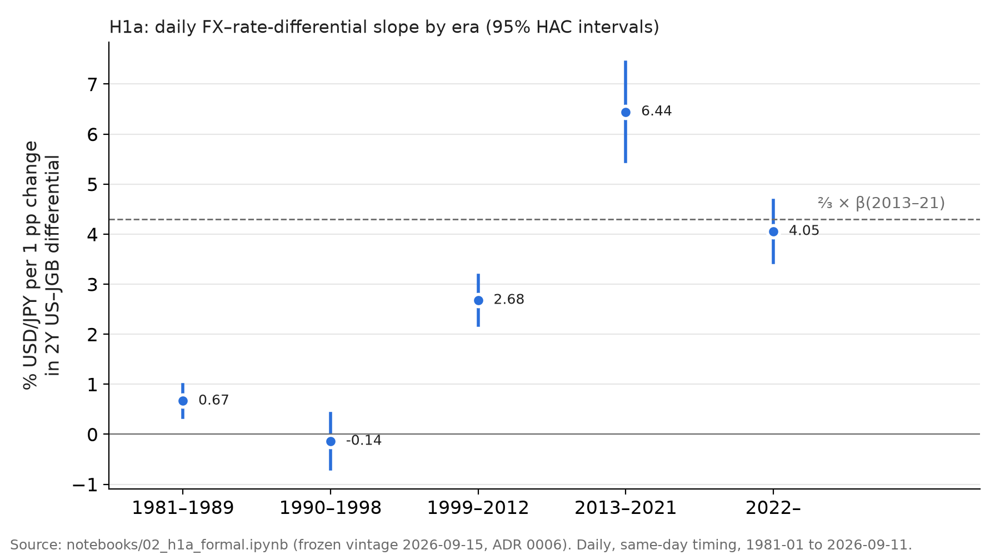
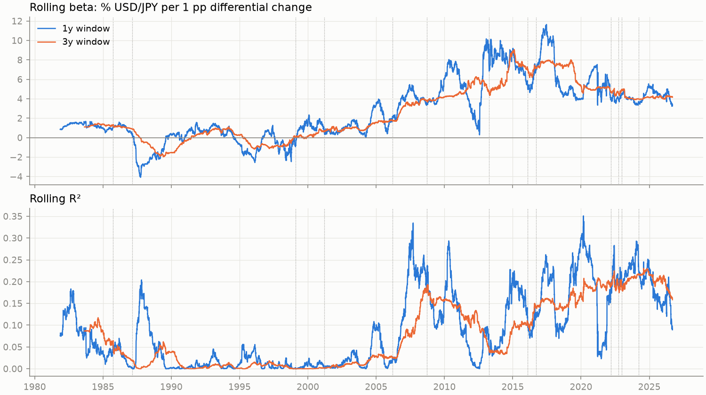

# H1a — Did the daily USD/JPY link to rate differentials weaken after 2022?

<strong>Outcome: inconclusive.</strong> The daily association fell from 6.44 to
4.05 % per percentage point, a −37 % change, but the pre-registered test cannot tell whether
that is a <em>material</em> decline (at least one-third) or a smaller one.

β 2013–2021 (reference)

6.44 <small>% per pp</small>

95 % [5.46, 7.43]

β 2022– (new)

4.05 <small>% per pp</small>

95 % [3.43, 4.67]

Relative change

−37 %

Fieller 95 % [−49 %, −22 %]

Pre-registered verdict

Inconclusive

pS = 0.30, pR = 0.70

Status: confirmatory, ADR 0006 (frozen 2026-10-09). Run once on the frozen data vintage of
2026-09-15. Every number below is copied from the executed
[`notebooks/02_h1a_formal.ipynb`](https://github.com/akiblasco/kagura/blob/main/notebooks/02_h1a_formal.ipynb).

---

???+ abstract "Concepts behind this report"
    **Textbook:** [ch. 1 log-points](../textbook/exchange-rates-logs-real-depreciation.md) ·
    [ch. 2 regression and coefficients](../textbook/regression-coefficients.md) ·
    [ch. 4 tests, intervals and the δ test](../textbook/hypothesis-testing-uncertainty.md).
    **Reference:** [OLS slope](../concepts/inference.md#ols-slope-as-covariance-over-variance) ·
    [R²](../concepts/inference.md#r-squared) · [HAC](../concepts/inference.md#hac-standard-errors) ·
    [one-sided tests](../concepts/inference.md#one-sided-tests-bounds-and-p-values) ·
    [gates and outcomes](../concepts/inference.md#pre-registration-gates-and-outcome-categories) ·
    [Fieller](../concepts/inference.md#fieller-confidence-sets) · [Wald](../concepts/inference.md#wald-tests) ·
    [Bonferroni](../concepts/inference.md#multiple-testing-and-bonferroni) ·
    [asynchronous closes](../concepts/data.md#asynchronous-market-closes-noon-fix-vs-tokyo-close) ·
    [exclusion rule](../concepts/data.md#carried-values-the-exclusion-rule-and-the-carried-share-guard) ·
    [rolling estimates](../concepts/inference.md#rolling-window-estimates).
    **Cheatsheet:** [inference](../cheatsheets/inference.md).

## 1. The question

KAGURA's research question is whether USD/JPY has structurally *decoupled* from the
US–Japan interest-rate differential. "Decoupling" has two meanings, and the project
separated them ([ADR 0006 §1](../../decisions/0006-h1-formal-testing-protocol.md)):

- **H1a, short run:** do daily *changes* in USD/JPY still move with daily *changes* in the
  differential as much as they did in 2013–2021?
- **H1b, long run:** do the *levels* still share an equilibrium? (See the [H1b report](02-h1b-long-run-fundamentals.md).)

**Why it matters economically.** The rate differential is the standard explanation for
the yen's 2022–2024 slide: US yields rose, Japanese yields stayed pinned, and carry
trades favoured the dollar. If the day-to-day link had weakened, then something other than
rates — risk sentiment, intervention, Japan's trade balance, capital flows — would be
carrying more of the yen's moves, and a rate-based reading of USD/JPY would overstate how
much a given change in rates moves the currency.

## 2. Data

| Series | Source | Frequency |
|---|---|---|
| USD/JPY | FRED `DEXJPUS` (Fed H.10, noon New York) | daily |
| US 2Y, 10Y Treasury | FRED `DGS2`, `DGS10` | daily |
| JGB 2Y, 10Y | Japan Ministry of Finance | daily |

- **Frozen vintage.** The files were downloaded on 2026-09-15 and their SHA-256 checksums
  written into ADR 0006 §9.2 before any model ran. The notebook refuses to run if a
  checksum differs ([`src/kagura/vintage.py`](https://github.com/akiblasco/kagura/blob/main/src/kagura/vintage.py)).
- **Sample.** Daily rows from 1981 to 2026-09-11; 10,279 rows used in the primary
  specification (2,007 in the reference era, 1,045 in the new era).
- **Exclusion rule (ADR 0004).** A day is used only if both changes span consecutive live
  observations, so no stale or filled value is differenced.

**Limitations.** USD/JPY is fixed at noon New York, US yields at about 15:30 and JGB
yields in the Tokyo afternoon, so the three daily changes cover different windows
(ADR 0006 §4.5). Same-day timing includes a few hours of US information the FX fix could
not yet reflect; it is a measure of comovement, not a forecast.

## 3. Method

**The regression** ([ADR 0006 §4.3](../../decisions/0006-h1-formal-testing-protocol.md)):

$$
\Delta s_t = \sum_{e} \mathbf{1}[t \in e]\,\bigl(\alpha_e + \beta_e\,\Delta d_t\bigr) + \varepsilon_t
$$

- Δs: daily % change in USD/JPY. Δd: daily change in the 2Y US–JGB differential, in pp.
- β_e: % move in USD/JPY associated with a 1 pp change in the differential, in era e. A
  100 bp narrowing is associated with a β_e % fall in USD/JPY.
- Eras: 1981–89, 1990–98, 1999–2012, **2013–21 (reference)**, **2022– (new)**.
- Newey–West HAC standard errors (lag 11), allowing heteroskedasticity and weak serial
  correlation.

**The decision rule.** A "material decline" was defined in advance as β falling below
two-thirds of its 2013–2021 value. The test uses

$$
\delta = \beta_{\text{new}} - \tfrac{2}{3}\,\beta_{\text{ref}}, \qquad z = \hat\delta / \widehat{\text{se}}(\hat\delta),
$$

which avoids dividing by an estimated coefficient:

| Test | Question | Result |
|---|---|---|
| **G** gate | Is there a positive reference association? | Yes (lower bound 5.46, p ≈ 10⁻³⁸) |
| **S** | Is β_new *below* ⅔·β_ref? | Not shown: δ = −0.24, upper bound +0.66, p_S = 0.30 |
| **R** | Is β_new *above* ⅔·β_ref? | Not shown: lower bound −1.15, p_R = 0.70 |

Each test uses one-sided α = 0.025: half of the H1 family's 0.05, the other half reserved
for H1b (Bonferroni). Neither S nor R rejects, so the verdict is **inconclusive**.

**Why this design.** The ⅓ threshold makes "material" concrete before seeing the answer;
a relative threshold is unaffected by a timing distortion that scales both eras by the
same factor; and two one-sided tests let the data say "declined", "did not decline
materially" or "cannot tell" — instead of reading a non-rejection as stability.

## 4. Results

<figure markdown>

<figcaption markdown>The interval around 2022– straddles the dashed ⅔ line. That is the picture behind
"inconclusive"; the formal test is on δ and uses the covariance of the two estimates, so
the chart is a visual aid, not the test.</figcaption>
</figure>

| Era | β (% per pp) | HAC se | R² |
|---|---:|---:|---:|
| 1981–1989 | 0.67 | 0.17 | 0.017 |
| 1990–1998 | −0.14 | 0.28 | 0.000 |
| 1999–2012 | 2.68 | 0.26 | 0.055 |
| **2013–2021** | **6.44** | 0.50 | 0.133 |
| **2022–** | **4.05** | 0.32 | 0.191 |

<figure markdown>

<figcaption>Rolling 1-year and 3-year slopes (top, % USD/JPY per 1 pp of the 2Y differential) and R² (bottom), daily data, 1981–2026. Descriptive, not part of the test. Dotted lines: ADR 0004 policy events. Source: reports/figures/h1a_rolling_beta.png (notebook 02).</figcaption>
</figure>

**Reading the results.**

- **The link is still strong.** β_new = 4.05 is far from zero and the second-highest era
  value in 45 years. R² is actually *higher* after 2022 (0.19 vs 0.13): the differential
  moved more, so it accounts for a larger share of FX variance even with a smaller slope.
- **It is smaller.** The absolute change is −2.39 % per pp (95 % [−3.56, −1.22]), clearly
  negative. What the data cannot settle is whether the drop exceeds one-third.
- **The long view matters more than 2022.** The slope rose from near zero before 1999 to
  its peak in 2013–2021. The era-equality Wald test rejects equal slopes overwhelmingly
  (χ²(4) = 239, p ≈ 10⁻⁵⁰; unadjusted, secondary). 2013–2021 is an unusually high
  reference, not a historical norm.

## 5. Robustness

| Variant | β_ref | β_new | Verdict |
|---|---:|---:|---|
| Primary (2Y, same-day, daily) | 6.44 | 4.05 | inconclusive |
| R1: lagged US leg | 1.43 | 0.75 | inconclusive |
| R2: monthly | 4.38 | 7.45 | ruled out |
| R3: 10Y differential | 4.99 | 4.20 | ruled out |

The pre-registered label is **"sensitive to R2 (ruled out), R3 (ruled out)"**. At the
monthly horizon and with the 10Y differential, a material decline is ruled out; monthly β
even *rises*. These variants measure different things (ADR 0006 §4.5), so the
disagreement is information, not noise: the weakening, if any, is specific to the daily 2Y
link.

**Two-leg decomposition (descriptive).** Splitting Δd into its US and JGB legs, the US
leg's coefficient in 2022– is 4.21 and the JGB leg's −0.19. The decomposition was added
because the JGB leg was pinned near zero for most of 1999–2022 (ADR 0006 §2).

## 6. What this does and does not establish

| Established | Not established |
|---|---|
| A positive daily association in every era since 1999 | That the association *materially* weakened after 2022 |
| A smaller 2022– slope than 2013–21 (absolute change negative) | That it stayed the same — inconclusive is not stability |
| The slope differs strongly across the five eras | Any causal effect of rates on the yen (common shocks, reverse causality) |
| | That 2022-01 is the right break date — it is a pre-specified candidate |

## 7. Open uncertainties

- **Break date.** If the change happened in 2023 or 2024, the "new" era mixes regimes and
  the contrast is biased toward no change. This is the motivation for Stage 2
  (structural-break dating).
- **Timing.** The comparison assumes the timing distortion is stable across eras (ADR 0006
  assumption A5). JGB yields move again since 2024, which may violate that.
- **Gate conditioning.** The error rate *conditional* on the gate passing is not
  controlled; here the gate passed by a very wide margin, so this is minor.

## 8. Provenance

| Item | Reference |
|---|---|
| Protocol | [ADR 0006](../../decisions/0006-h1-formal-testing-protocol.md), frozen 2026-10-09 |
| Exploratory spec | [ADR 0004](../../decisions/0004-h1-exploratory-specification.md) |
| Notebook | [`notebooks/02_h1a_formal.ipynb`](https://github.com/akiblasco/kagura/blob/main/notebooks/02_h1a_formal.ipynb) (`make h1a`) |
| Code | `src/kagura/models.py`, `src/kagura/h1a.py` |
| Data | frozen vintage 2026-09-15, checksums in ADR 0006 §9.2 |
| Result commit | `2c5b446` (2026-10-21). The notebook records HEAD `dd8d04f` with a modified working tree at run time |
| Environment | Python 3.12.8, pandas 3.0.5, numpy 2.5.3, statsmodels 0.15.0; no randomness |
| Figure above | `docs/learning/reports/make_figures.py`, read from the notebook's saved output |
