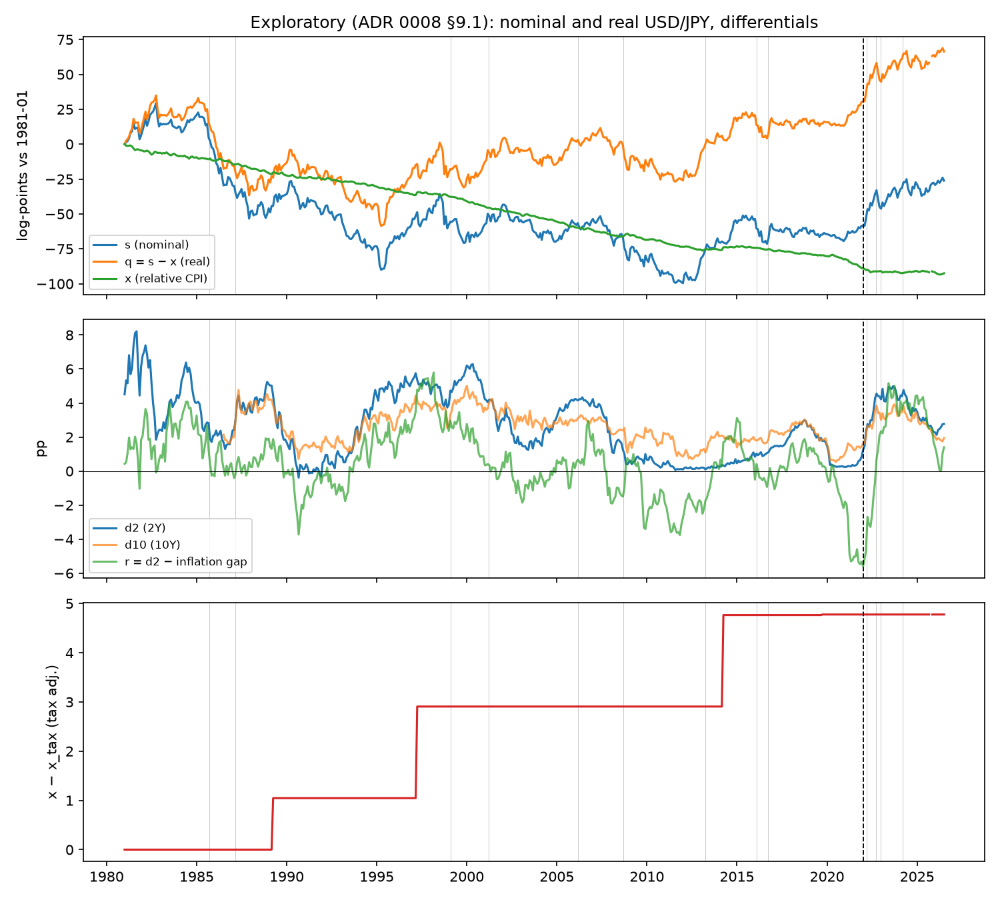
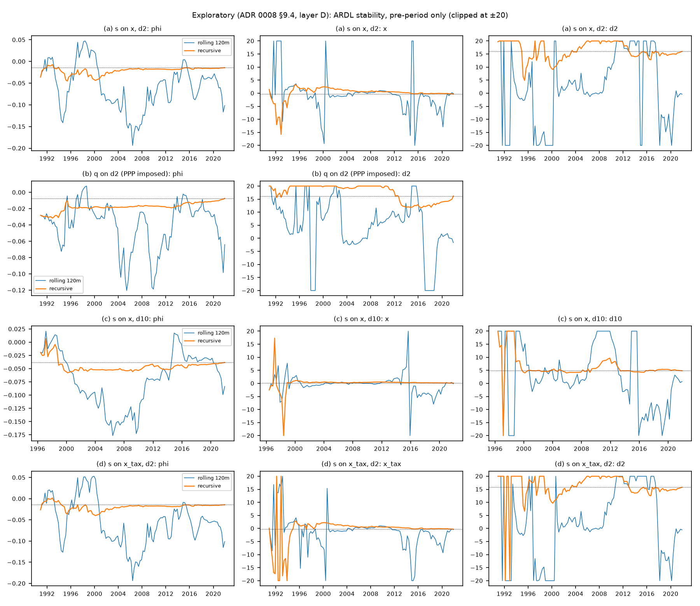

# H1b — Long-run fundamentals and the missing benchmark

<strong>Outcome: not assessable, then not defensible.</strong> No valid test of
the frozen long-run hypothesis exists for this design, so it was not run. Exploratory
models of the pre-2022 levels then found no relationship stable enough to serve as a
model-implied benchmark for USD/JPY.

Confirmatory claim

Not assessable

α = 0.025 unused, not reallocated

Methods rejected

2 of 2

Andrews–Kim; Wagner–Wied (synthetic-data pilots)

Real depreciation 2021-12 → 2026-07

+36.1 <small>log-pts</small>

Nominal +32.4; relative prices −3.8

Exploratory benchmark

None justified

All 4 specifications not defensible

Status: [ADR 0008](../../decisions/0008-h1b-long-run-protocol.md), frozen 2026-10-24.
Everything after §3 is **exploratory**: 5 % is a descriptive reference, not a test of
the frozen claim (ADR 0008 §7.1).

---

???+ abstract "Concepts behind this report"
    **Textbook:** [ch. 1 real exchange rate](../textbook/exchange-rates-logs-real-depreciation.md) ·
    [ch. 3 stationarity and unit roots](../textbook/stationarity-unit-roots.md) ·
    [ch. 4 Monte Carlo size](../textbook/hypothesis-testing-uncertainty.md#10-does-the-test-do-what-it-says-monte-carlo-size-and-power).
    **Reference:** [PPP and real rates](../concepts/economics.md#purchasing-power-parity-nominal-vs-real-exchange-rate) ·
    [tax steps](../concepts/economics.md#consumption-tax-steps-in-japanese-cpi) ·
    [unit roots, ADF/KPSS](../concepts/time-series.md#stationarity-and-unit-roots) ·
    [cointegration](../concepts/time-series.md#cointegration-and-error-correction) ·
    [ARDL bounds](../concepts/time-series.md#ardl-and-the-pesaranshinsmith-bounds-test) ·
    [lag selection](../concepts/time-series.md#lag-selection-aic-and-breuschgodfrey-filtering) ·
    [FM-OLS/D-OLS](../concepts/time-series.md#fm-ols-and-d-ols) · [half-life](../concepts/time-series.md#half-life) ·
    [Andrews–Kim](../concepts/time-series.md#andrewskim-end-of-sample-cointegration-breakdown-test) ·
    [Wagner–Wied](../concepts/time-series.md#wagnerwied-cointegration-monitoring) ·
    [Monte Carlo size/power](../concepts/inference.md#monte-carlo-size-and-power) ·
    [specification search](../concepts/methodology.md#specification-search-and-the-garden-of-forking-paths).
    **Cheatsheets:** [FX and PPP](../cheatsheets/fx-inflation-ppp.md) · [time series](../cheatsheets/time-series.md).

## 1. The question

H1a looked at daily *changes*. H1b asks about *levels*: did USD/JPY, relative prices and
the rate differential share a long-run equilibrium before 2022, and did it break after?

| Symbol | Definition |
|---|---|
| \(s\) | 100 · ln(USD/JPY), month-end |
| \(x\) | 100 · ln(CPIJP / CPIUS) — relative prices |
| \(d\) | US 2Y − JGB 2Y, pp |

**Why it matters.** A stable levels relation would let one compute a *model-implied
benchmark* for USD/JPY and ask how far the 2022–2026 yen sits from it. Without one, any
statement like "the yen is X % undervalued" has no model behind it. ADR 0008 §7.2 bans
"fair value" and similar wording for exactly this reason.

**The intended test** (ADR 0008 §2): a bounds-test gate for a pre-period relation over
1981-01 to 2021-12 (T = 492 months), then one end-of-sample breakdown test over
2022-01 to 2026-07 (m = 55 months) at α = 0.025.

## 2. The search for a valid confirmatory test

A candidate had to meet four requirements, fixed in advance (ADR 0008 §3): its theory
covers this design (drifting relative prices, a differential of uncertain integration
order); its full-procedure size at nominal 2.5 % is close to 2.5 % at T = 492, m = 55; its
tuning is fixed in advance; and its published equations and critical values can be
reproduced.

### Andrews–Kim (2006) end-of-sample test — rejected

- **Verified first.** The implementation reproduced the paper's Table 1 within Monte Carlo
  error (e.g. 0.0554 vs 0.057 at ρ = 0).
- **Then it failed at our dimensions.** Null rejection at nominal 0.025 was
  **0.047–0.107** in every main simulation cell.
- **Structurally infeasible.** With 438 subsample windows the smallest attainable p-value
  is 1/438, and under the null P(p ≤ 1/438) was already 0.035–0.087. No critical value can
  give a 2.5 % test.

### Wagner–Wied (2017) cointegration monitoring — rejected

- **Source discrepancy.** Only the working-paper/package form of the detector reproduced
  the published critical values; the journal's equation did not. Documented, not
  adjudicated.
- **Theory does not cover the design** (decisive). It assumes driftless random-walk
  regressors; our relative prices drift, and the differential may be stationary.
- **Size depended on the bandwidth rule** (0.02 to 0.90 across rules), and **power was
  0.02–0.08** against 1–2 σ breaks at realistic persistence.

**Decision.** H1b's confirmatory claim is **not assessable**; its α is unused; the method
search is closed, because continuing would become a specification search over tests
(ADR 0008 §6). The pilot code and outputs are archived in
`research/methodology/adr0008-h1b-confirmatory-pilots/`.

!!! warning "What this does not mean"
    "Not assessable" is not "no decoupling" and not "decoupling". No test was run on real
    data. The pilot persistence values were design points, not estimates for USD/JPY.

## 3. Exploratory Stage 1: is there a defensible long-run baseline?

### What happened to the yen

<figure markdown>

<figcaption>Top: nominal s, real q = s − x and relative CPI x, log-points relative to
1981-01. Middle: 2Y and 10Y differentials and a real-rate differential r, pp. Bottom: the
consumption-tax adjustment x − xtax. Monthly, 1981-01 to 2026-07. Dashed line:
2022-01. Click to enlarge. Source: notebook 03 (ADR 0008 §9.1).</figcaption>
</figure>

- From 2021-12 to 2026-07, USD/JPY rose from 115.2 to 159.2: **+32.4 log-points
  nominal**, **+36.1 real**. Japanese prices rose *less* than US prices (x fell by 3.8),
  so the depreciation was entirely real.
- The 55-month real move is large by 1981–2021 standards (95th percentile of pre-2022
  55-month moves: 34.8) but not unprecedented (maximum 47.4).

### Integration order

Over 1981–2021, ADF and KPSS classify s, q, x, the tax-adjusted x and both differentials
as **I(1)**, with no I(2) risk. That makes the ARDL bounds test, FM-OLS and D-OLS all
applicable. The classification is sample-dependent: starting in 1990, the real
exchange rate q and the 2Y differential become ambiguous.

### The bounds test: four candidate relationships

The ARDL bounds test (Pesaran–Shin–Smith, Case III) asks whether a levels relation
exists, without knowing whether the regressors are I(0) or I(1). In error-correction form:

$$
\Delta y_t = c + \phi\, y_{t-1} + \pi' X_{t-1}
+ \sum_{i=1}^{p-1} a_i\, \Delta y_{t-i} + \sum_{j=0}^{q-1} b_j' \Delta X_{t-j} + u_t
$$

A levels relation needs \(\phi < 0\), tested jointly with \(\pi\) by F and alone by t.
Statistics beyond the **I(1) bound** indicate a relation; inside the **I(0) bound**,
none.

| Spec | F | F bounds | t | t bounds | Verdict |
|---|---|---|---|---|---|
| (a) s on x, d2 | 4.08 → 3.35 | 3.79 / 4.85 | −1.87 → −1.20 | −2.86 / −3.53 | not defensible |
| (b) q on d2 | 1.88 → 2.05 | 4.94 / 5.73 | −0.98 → −0.66 | −2.86 / −3.22 | not defensible |
| (c) s on x, d10 | 3.51 → 2.89 | 3.79 / 4.85 | −2.98 → −2.76 | −2.86 / −3.53 | not defensible |
| (d) s on xtax, d2 | 3.97 → 3.17 | 3.79 / 4.85 | −1.88 → −1.29 | −2.86 / −3.53 | not defensible |

*F and t: original Stage 1 → draft-design sensitivity variant. Bounds: I(0) / I(1), PSS asymptotic 5 %. Finite-sample simulated 95 % quantiles of the full selection
procedure are similar or stricter (F 4.7–5.8, t −3.2 to −3.6). The sensitivity variant is described in §4. Source: notebooks 03 and 04.*

- **No statistic crosses an I(1) bound** in either variant.
- Long-run coefficients are implausible and imprecise: in (a), relative prices enter with
  the wrong sign (−0.30, HAC se 0.73; −1.04, se 1.66 in the sensitivity variant).
- FM-OLS and D-OLS disagree with the ARDL (relative-price coefficient ≈ 0.8, differential
  ≈ 0), so the estimators do not agree on a relation either.

### Stability

<figure markdown>

<figcaption>Rolling 120-month (blue) and recursive (orange) estimates of the adjustment
speed φ and long-run coefficients for each specification, pre-2022 only, clipped at ±20.
Dotted line: full-sample estimate. Click to enlarge. Source: notebook 03 (ADR 0008 §9.4).</figcaption>
</figure>

By era (ADR 0004 eras, ARDL at the full-sample orders), adjustment is fastest in 2013–2021
and absent in 1990–1998, in both the original run and the audit's sensitivity variant (§4):

| Era estimates, specs (a)–(d) | Original Stage 1 (notebook 03) | Sensitivity variant (notebook 04) |
|---|---|---|
| 2013–2021 φ per month | −0.095 to −0.191 | −0.077 to −0.162 |
| 2013–2021 differential long-run coefficient | −1.72 to +0.61 | −3.02 to +0.71 |
| 1990–1998 φ per month | −0.016 to +0.050 (positive in (a), (d)) | −0.001 to +0.008 |
| 1990–1998 differential long-run coefficient | −26.2 to +59.1 | −276.4 to +241.3 (HAC s.e. 312 to 6,229) |

There is no stable anchor to carry forward into 2022.

## 4. The specification audit

Stage 1 had simplified the ARDL design proposed in the superseded ADR 0008 drafts. The
audit (notebook 04, commit `ca8ebd3`) re-ran all four specifications under that design as
a **sensitivity analysis**:

| Element | Source | Original run | Sensitivity variant |
|---|---|---|---|
| Case III, BG-filtered AIC, lags ≤ 12 | **frozen ADR 0008** | yes | yes |
| 11 seasonal dummies, lagged tax impulses | superseded drafts r2/r3 | no | yes |
| Independent lag orders (1,728 models) | superseded draft r2 | one shared q | yes |
| Designs for (b)–(d) | added during the audit | — | disclosed |

**Result.** F fell for (a), (c) and (d) and **rose for (b)** (1.88 → 2.05, still below
its I(0) bound); every |t| fell. No classification changed.

## 5. What this does and does not establish

| Established | Not established |
|---|---|
| No valid confirmatory test exists for this design among the methods evaluated | Whether the long-run relation broke down after 2022 |
| 1981–2021 data do not identify a stable levels anchor linking USD/JPY, relative prices and the differential | That no such relation exists: bounds tests have low power when deviations are persistent |
| The 2022–2026 depreciation was real, not driven by relative prices | Any "fair value" or misalignment estimate |

**Half-life.** Point estimates (26–144 months) are descriptive only. The bootstrap
intervals were not used: they rebuild data from a stable fitted model, so they cannot
represent a unit root, and persistence is weakly identified.

## 6. Open uncertainties

- Structural breaks (e.g. the Plaza era) could hide a levels relation in sub-periods.
- Simulated critical values assume driftless Gaussian random walks; relative prices drift
  and residuals have fat tails.
- The (a) sensitivity selection passes the serial-correlation filter only at p = 0.051.
- The dummy designs for (b)–(d) are the audit's own mapping.

## 7. Provenance

| Item | Reference |
|---|---|
| Protocol | [ADR 0008](../../decisions/0008-h1b-long-run-protocol.md), frozen 2026-10-24 (`a37f5d6`) |
| Pilot archive | `research/methodology/adr0008-h1b-confirmatory-pilots/` (`run_all.sh`) |
| Stage 1 | `notebooks/03_h1b_exploratory.ipynb` (`make h1b-explore`), commit `8fba5b6` |
| Audit | `notebooks/04_h1b_stage1_audit.ipynb`, commit `ca8ebd3` |
| Code | `src/kagura/longrun.py` |
| Data | frozen vintage 2026-09-15 plus two CPI files checksummed in `src/kagura/vintage.py` |
