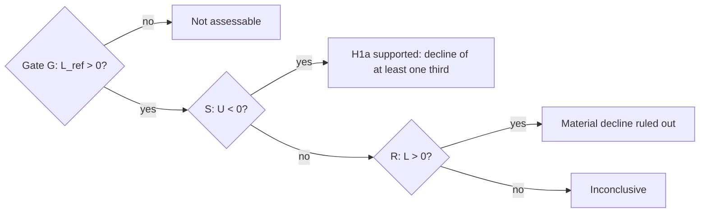

# Hypothesis testing, confidence intervals and statistical uncertainty

H1a estimated that the daily rate link fell by 37 %. Yet its verdict is
"inconclusive", not "it fell by more than a third". This chapter builds, from the normal
distribution upward, the machinery behind that verdict: standard errors, confidence
intervals, one-sided tests, p-values, tests of combinations and ratios, multiple testing,
and simulation-based checks of whether a test does what it claims.

Chapter 4
Beginner → intermediate, with advanced boxes
Used in H1a; ADR 0008 pilots

!!! abstract "What you will be able to do"
    1. Standardise a normal variable and use \(\Phi\) and \(\Phi^{-1}\).
    2. Derive a confidence interval from a sampling distribution, and interpret it correctly.
    3. Set up one- and two-sided tests; define size, power, type I and type II errors.
    4. Compute H1a's δ, its standard error, z, \(p_S\), \(p_R\) and bounds from notebook
       outputs, and explain the four outcome categories.
    5. Explain why ratios need Fieller sets, and derive one.
    6. Explain Bonferroni splitting, Wald tests and Monte Carlo size/power checks.

**Prerequisites.** [Chapter 2](regression-coefficients.md) (OLS, standard errors).

---

## 1. Intuition: an estimate is one draw

Had history delivered different daily news, the 2013–2021 slope would not have been
exactly 6.44. An estimate is one draw from a distribution of possible estimates: its
**sampling distribution**. Inference asks what that distribution lets us say about the
unknown true value.

The chart shows a classroom version: we know the true mean (2), draw 50 samples, and build
a 95 % interval from each.

Fifty 95 % confidence intervals for a known mean

Each row is one simulated sample of 25 observations. Intervals that miss the true value are marked separately.

Illustrative: simulated with a fixed seed, not KAGURA data. In the long run, 95 % of
intervals built this way cover the true mean. In any one set of 50, the count of misses varies around 2.5.

"95 %" describes the **procedure**: across repeated samples, 95 % of intervals cover the
truth. It is not the probability that one computed interval contains the truth. The
truth is fixed, so a given interval either does or does not.

## 2. The normal distribution and standardising

A normal random variable \(X \sim N(\mu, \sigma^2)\) has a bell-shaped density centred at
\(\mu\) with spread \(\sigma\). **Standardising** maps any normal onto the standard normal:

$$
Z = \frac{X - \mu}{\sigma} \sim N(0, 1).
$$

(Using \(E[a + bX] = a + bE[X]\): \(E[Z] = (\mu - \mu)/\sigma = 0\); and
\(\operatorname{Var}(Z) = \operatorname{Var}(X)/\sigma^2 = 1\).)

| Notation | Meaning | Key values |
|---|---|---|
| \(\Phi(z) = P(Z \le z)\) | cumulative distribution function | \(\Phi(0) = 0.5\); \(\Phi(-z) = 1 - \Phi(z)\) |
| \(\Phi^{-1}(p)\) | quantile: the \(z\) with \(\Phi(z) = p\) | \(\Phi^{-1}(0.975) = 1.959964\); \(\Phi^{-1}(0.95) = 1.645\) |

ADR 0006 writes \(c = \Phi^{-1}(0.975) = 1.959964\). So \(P(-c \le Z \le c) = 0.95\) and
\(P(Z \le -c) = 0.025\).

## 3. The sampling distribution of a slope

For large samples (and under the HAC conditions of chapter 2), an OLS slope is
approximately normal around the true \(\beta\), with standard deviation equal to its
standard error:

$$
\hat\beta \;\overset{\text{approx}}{\sim}\; N\big(\beta,\ \operatorname{se}(\hat\beta)^2\big)
\quad\Longrightarrow\quad
\frac{\hat\beta - \beta}{\operatorname{se}(\hat\beta)} \;\overset{\text{approx}}{\sim}\; N(0, 1).
$$

The approximation comes from the central limit theorem: \(\hat\beta - \beta\) is a
weighted average of many error terms (chapter 2 §9.1). ADR 0006 assumption A7 names it,
with about 2,000 reference and 1,000 new daily rows supporting it.

## 4. Confidence intervals, derived

Start from the probability statement for the standardised estimate:

$$
P\!\left(-c \le \frac{\hat\beta - \beta}{\operatorname{se}} \le c\right) = 0.95 .
$$

Multiply all three parts by \(\operatorname{se} > 0\):
\(P(-c\,\operatorname{se} \le \hat\beta - \beta \le c\,\operatorname{se}) = 0.95\).
Subtract \(\hat\beta\): \(P(-\hat\beta - c\,\operatorname{se} \le -\beta \le -\hat\beta +
c\,\operatorname{se}) = 0.95\). Multiply by −1, which **reverses the inequalities**:

$$
P\big(\hat\beta - c\,\operatorname{se} \le \beta \le \hat\beta + c\,\operatorname{se}\big) = 0.95 .
$$

The random interval \(\hat\beta \pm c\,\operatorname{se}\) covers \(\beta\) with
probability 0.95.

!!! example "H1a reference slope (verified, notebook 02)"
    \(\hat\beta_{\text{ref}} = 6.4446\), \(\operatorname{se} = 0.5040\).
    \(6.4446 \pm 1.96 \times 0.5040 = 6.4446 \pm 0.9879 = [5.457,\ 7.433]\),
    as reported. For 2022–: \(4.0546 \pm 1.96 \times 0.3164 = [3.435,\ 4.675]\).

**One-sided bounds.** Using only one tail at 2.5 % gives a one-sided 97.5 % bound:
\(L = \hat\beta - c\,\operatorname{se}\) (lower) or \(U = \hat\beta + c\,\operatorname{se}\)
(upper). The two-sided 95 % interval is exactly \([L, U]\), which is why ADR 0006 §5.2 can
display two-sided intervals that agree with one-sided decision rules.

## 5. Hypothesis tests

### 5.1 The vocabulary

| Term | Meaning |
|---|---|
| null hypothesis \(H_0\) | the claim kept unless the data argue strongly against it |
| alternative \(H_1\) | the claim we want evidence *for* |
| test statistic | a number computed from data whose distribution under \(H_0\) is known |
| rejection region | values of the statistic that lead to rejecting \(H_0\) |
| size / level \(\alpha\) | P(reject \(H_0\) when \(H_0\) is true): the false-positive rate |
| type I error | rejecting a true \(H_0\) |
| type II error | not rejecting a false \(H_0\) |
| power | P(reject \(H_0\) when \(H_1\) is true) = 1 − P(type II) |

The asymmetry is deliberate: we control \(\alpha\) exactly and accept that power may be
low. That is why **not rejecting is not evidence for \(H_0\)**.

### 5.2 Two-sided and one-sided

To test \(H_0: \beta = \beta_0\), use \(z = (\hat\beta - \beta_0)/\operatorname{se}\).

| Alternative | Reject if | p-value |
|---|---|---|
| \(\beta \ne \beta_0\) (two-sided) | \(\lvert z\rvert > 1.96\) at α = 0.05 | \(2(1 - \Phi(\lvert z\rvert))\) |
| \(\beta > \beta_0\) | \(z > c\) at α = 0.025 | \(1 - \Phi(z)\) |
| \(\beta < \beta_0\) | \(z < -c\) at α = 0.025 | \(\Phi(z)\) |

A one-sided test puts all of \(\alpha\) in the direction of interest. H1a uses one-sided
tests because its claims are directional ("declined by at least a third").

### 5.3 p-values

The **p-value** is the probability, computed assuming \(H_0\) is true (at its boundary), of
a test statistic at least as extreme as the one observed, in the direction of \(H_1\).
Reject when \(p < \alpha\). Equivalent: the observed statistic falls in the rejection region,
and the one-sided bound excludes the null value.

A p-value is **not**:

- the probability that \(H_0\) is true;
- the probability that the result is due to chance;
- a measure of the size or importance of an effect.

## 6. Testing a combination of coefficients: H1a's δ

### 6.1 Turning a ratio claim into a linear one

H1a's claim is "β fell by at least one third": \(\beta_{\text{new}} < \tfrac23\beta_{\text{ref}}\).
Subtract the right side:

$$
\delta = \beta_{\text{new}} - \tfrac{2}{3}\beta_{\text{ref}} < 0 .
$$

Testing \(\delta\) avoids dividing by an estimated \(\beta_{\text{ref}}\) (ADR 0006 §5).

### 6.2 The variance of a linear combination

For random variables \(X, Y\) and constants \(a, b\):

$$
\operatorname{Var}(aX + bY) = a^2\operatorname{Var}(X) + b^2\operatorname{Var}(Y) + 2ab\operatorname{Cov}(X,Y).
$$

*Derivation.* Write \(\tilde X = X - E X\), \(\tilde Y = Y - EY\). Then
\(\operatorname{Var}(aX+bY) = E[(a\tilde X + b\tilde Y)^2] = a^2E[\tilde X^2] + b^2E[\tilde
Y^2] + 2abE[\tilde X\tilde Y]\).

With \(a = 1\), \(b = -\tfrac23\):

$$
\operatorname{Var}(\hat\delta) = \operatorname{se}_{\text{new}}^2 + \tfrac49\operatorname{se}_{\text{ref}}^2 - \tfrac43\operatorname{Cov}(\hat\beta_{\text{new}}, \hat\beta_{\text{ref}}).
$$

### 6.3 The numbers (verified, notebook 02)

| Quantity | Value |
|---|---|
| \(\hat\beta_{\text{new}}\), se | 4.054640, 0.316400 |
| \(\hat\beta_{\text{ref}}\), se | 6.444615, 0.504048 |
| \(\hat\delta = 4.054640 - \tfrac23(6.444615)\) | 4.054640 − 4.296410 = **−0.241770** |
| \(\operatorname{se}(\hat\delta)\) reported | **0.461512** |

Check by hand: \(0.3164^2 + \tfrac49(0.504048)^2 = 0.100109 + 0.112918 = 0.213027\), and
\(\sqrt{0.213027} = 0.461548\). This matches the reported 0.461512 to four decimals, so the
HAC covariance between the two era slopes is essentially zero. That makes sense: the eras
use different days.

### 6.4 Gate, S and R

$$
z = \frac{\hat\delta}{\operatorname{se}(\hat\delta)} = \frac{-0.241770}{0.461512} = -0.524 .
$$

**G, the gate.** \(H_0: \beta_{\text{ref}} \le 0\). Lower bound
\(L_{\text{ref}} = 6.4446 - 1.96(0.5040) = 5.457 > 0\); \(z = 12.8\), \(p \approx 10^{-38}\).
**Passes.**

**S, material decline.** \(H_0: \delta \ge 0\) against \(H_1: \delta < 0\).
\(p_S = \Phi(-0.524) = 0.300\). Upper bound \(U = -0.2418 + 1.96(0.4615) = 0.663\).
\(U > 0\): **not rejected.**

**R, material decline ruled out.** \(H_0: \delta \le 0\) against \(H_1: \delta > 0\).
\(p_R = 1 - 0.300 = 0.700\). Lower bound \(L = -0.2418 - 1.96(0.4615) = -1.146\).
\(L < 0\): **not rejected.**

Test S on the z scale

If δ were exactly 0, z would follow the standard normal. S rejects only if z falls in the
orange 2.5 % tail. The observed z = −0.52 leaves 30 % of the distribution to its left.

Source: δ̂ = −0.241770 and se(δ̂) = 0.461512, notebook 02 (ADR 0006 §5.1). Curve is the
theoretical N(0, 1).

### 6.5 Four outcomes, fixed in advance

S and R cannot both reject, since \(U < 0\) and \(L > 0\) are incompatible. With
\(U = 0.66\) and \(L = -1.15\) the interval contains zero: the data are compatible both with
a decline of more than a third and with a smaller one. **Inconclusive is not stability.**
"No evidence of a material decline" is not "evidence of no material decline" (ADR 0006 §5.1).

### 6.6 How the verdict depends on the threshold

ADR 0006 §5.2 also reports δ at the ¼ and ½ thresholds, as sensitivity analyses that never
enter the decision.

95 % intervals for δ at three materiality thresholds

An interval entirely left of zero would support a decline at that threshold; entirely
right of zero rules it out.

Source: notebook 02 output. ¼: δ̂ = −0.78 [−1.74, 0.19]; ⅓: −0.24 [−1.15, 0.66];
½: 0.83 [0.04, 1.63]. Only the ⅓ row is the pre-registered test.

Read together: a decline of half or more is ruled out at the sensitivity level, while the
data can't decide between a decline of more than a quarter, more than a third, or less.
This is descriptive. Choosing the threshold after seeing this chart would be tuning, which
is why ADR 0006 fixed ⅓ in advance.

??? info "Advanced: the gate is a pretest"
    A false "supported" requires both G to pass and S to reject, so the unconditional error
    rate stays ≤ 0.025. The error rate *conditional on* G having passed is not controlled and
    can exceed 0.025 when G passes narrowly. Here G passed with \(z \approx 12.8\), so this
    is minor (ADR 0006 §5.1).

## 7. Uncertainty of a ratio: Fieller's method

The relative change \(\beta_{\text{new}}/\beta_{\text{ref}} - 1 = 4.0546/6.4446 - 1 = -0.371\)
is easy to communicate. But a ratio of two estimates is not normally distributed, and if the
denominator could be near zero its distribution has extremely heavy tails.

**Fieller's idea.** Instead of the distribution of the ratio, ask, for each candidate ratio
\(\rho\), whether \(\beta_{\text{new}} - \rho\,\beta_{\text{ref}} = 0\) is rejected. That
combination *is* linear and approximately normal. Collect every \(\rho\) not rejected:

$$
\frac{(\hat\beta_{\text{new}} - \rho\hat\beta_{\text{ref}})^2}{\operatorname{se}_{\text{new}}^2 + \rho^2\operatorname{se}_{\text{ref}}^2 - 2\rho\operatorname{Cov}} \le c^2 .
$$

Multiplying out gives a quadratic inequality \(A\rho^2 + B\rho + C \le 0\) with (taking
Cov ≈ 0, as found in §6.3)

$$
A = \hat\beta_{\text{ref}}^2 - c^2\operatorname{se}_{\text{ref}}^2,\quad
B = -2\hat\beta_{\text{new}}\hat\beta_{\text{ref}},\quad
C = \hat\beta_{\text{new}}^2 - c^2\operatorname{se}_{\text{new}}^2 .
$$

Numbers: \(A = 41.533 - 0.976 = 40.557\); \(B = -52.261\); \(C = 16.440 - 0.385 = 16.055\).
The roots \(\rho = (-B \pm \sqrt{B^2 - 4AC})/(2A)\) are \(0.5056\) and \(0.7830\). As relative
changes: **[−49.4 %, −21.7 %]**, matching notebook 02's [−0.4944, −0.2170].

If \(A < 0\) (the denominator is not significantly different from zero), the set becomes
unbounded or a union of two intervals. ADR 0006 requires reporting it as such, "never
truncated or replaced by the delta method".

!!! tip "Two views, one answer"
    A one-third decline (−33 %) lies inside the Fieller set [−49 %, −22 %], just as 0 lies
    inside δ's interval [−1.15, 0.66]. Both say the same thing: the data cannot tell a
    decline of a third apart from the estimate of −37 %. (The two procedures are closely
    related but not numerically identical, so their endpoints don't map one to one.)

## 8. Testing several restrictions at once: the Wald test

To test "β is equal in all five eras", there are four restrictions
(\(\beta_1 = \beta_2,\ \dots,\ \beta_4 = \beta_5\)). Stack them as \(R\beta = 0\). The
**Wald statistic** measures how far \(R\hat\beta\) is from zero, scaled by its covariance:

$$
W = (R\hat\beta)'\,\big[R\,\hat V\,R'\big]^{-1}(R\hat\beta) \;\overset{\text{approx}}{\sim}\; \chi^2(q),
$$

with \(q\) the number of restrictions. For a single restriction it is just \(z^2\). In H1a
(ADR 0006 §6.1, secondary, unadjusted): \(W = 239\) with \(q = 4\), \(p \approx 10^{-50}\).
The slopes differ strongly across eras.

## 9. Many tests: controlling the family-wise error

If you run two tests each at 5 %, the chance of at least one false positive can approach
10 %. **Boole's inequality** bounds it: \(P(A \cup B) \le P(A) + P(B)\). So splitting a
budget \(\alpha_{\text{FW}}\) as \(\alpha_1 + \alpha_2 = \alpha_{\text{FW}}\) guarantees
family-wise error ≤ \(\alpha_{\text{FW}}\), under any dependence. This is **Bonferroni**.

KAGURA (ADR 0006 §8): the H1 family {H1a, H1b} has α = 0.05, split 0.025 each. Bonferroni
was chosen over Holm because Holm would make H1a's final status depend on H1b's p-value,
so H1a could not be finalised first. H1b then spent nothing (ADR 0008 §0), and the unused
0.025 was **not** reallocated.

## 10. Does the test do what it says? Monte Carlo size and power

A test's nominal α is a promise derived from theory. Whether it holds at your sample size,
with your data's features, is an empirical question you can answer by **simulation**:

1. Generate many synthetic datasets in which \(H_0\) is true (a chosen data-generating
   process, DGP).
2. Run the full procedure, including lag selection and every tuning step, on each.
3. The share of rejections estimates the true size.
4. Repeat with \(H_0\) false to estimate power.

With \(R\) replications, the simulated rejection rate \(\hat p\) has standard error
\(\sqrt{\hat p(1-\hat p)/R}\). At \(p = 0.025\) and \(R = 4{,}000\): \(\sqrt{0.025 \times
0.975/4000} = 0.0025\).

!!! example "KAGURA: Andrews–Kim fails its size check (verified, ADR 0008 §4)"
    At nominal 0.025, with T = 492 and m = 55 and 4,000 replications per cell, the
    end-of-sample test rejected a true null **4.7 % to 10.7 %** of the time. That is about 9
    to 33 Monte Carlo standard errors above 2.5 %, far beyond simulation noise. Worse, the smallest attainable p-value
    was 1/438, and even that was reached under the null 3.5–8.7 % of the time, so no critical
    value could deliver a 2.5 % test. This is a finding about the method on **synthetic**
    data, not about USD/JPY. See the [case study](../journal/h1b-methodological-journey.md).

## 11. Statistical and economic significance; exploratory p-values

- **Statistical ≠ economic significance.** H1a's gate p ≈ 10⁻³⁸ says β_ref is surely
  positive. It says nothing about whether 6.44 % per pp is large. The ⅓ threshold is
  KAGURA's explicit, pre-chosen definition of "material".
- **Exploratory p-values do not inherit α.** In H1b's exploratory work, 5 % is a
  descriptive reference with no error-rate guarantee (ADR 0008 §7.1). A p-value from a
  specification chosen after looking at data does not mean what a pre-registered one does.

## 12. Where KAGURA uses this

| Concept | Where | Read more |
|---|---|---|
| CIs, one-sided bounds | H1a §5.1 decision rules | [Concept: one-sided tests](../concepts/inference.md#one-sided-tests-bounds-and-p-values) |
| Linear combination δ | H1a test quantity | `kagura.models.delta`, `rejects_below`, `rejects_above` |
| Outcome categories | ADR 0006 §5.1 | [Concept: pre-registration](../concepts/inference.md#pre-registration-gates-and-outcome-categories) |
| Fieller | H1a relative change | `kagura.models.fieller`; [concept](../concepts/inference.md#fieller-confidence-sets) |
| Wald | era equality χ²(4) = 239 | `kagura.models.wald`, `era_equality` |
| Bonferroni | H1 family | [Concept: multiple testing](../concepts/inference.md#multiple-testing-and-bonferroni) |
| Monte Carlo size/power | ADR 0008 pilots | [Concept: Monte Carlo](../concepts/inference.md#monte-carlo-size-and-power) |

## 13. Common mistakes

1. **"p = 0.30, so there is a 30 % chance H0 is true."** No: p is computed assuming H0.
2. **"Not significant, so no effect."** Low power; and H1a's inconclusive verdict is
   precisely the case where that inference fails.
3. **"There is a 95 % probability β lies in this interval."** The procedure has 95 %
   coverage; a computed interval either covers or not.
4. **Ignoring covariance when testing a combination.** Here it happened to be ≈ 0; with
   overlapping samples it is not.
5. **Delta-method intervals for ratios with imprecise denominators.**
6. **Picking the threshold, test direction or sample after seeing results.**
7. **Trusting nominal α without checking size at your T** (the Andrews–Kim lesson).

## 14. Defending it in an interview

> *"Your point estimate is a 37 % decline, above your one-third threshold. Why not call it
> supported?"*
> Because the estimate is uncertain: the one-sided 97.5 % upper bound on δ is +0.66, above
> zero, so we cannot exclude a decline smaller than a third. We also cannot exclude a
> larger one. The pre-registered verdict for that case is inconclusive.

> *"Isn't inconclusive just a failure?"*
> It is an informative result. A material decline at the monthly horizon and with 10Y yields
> is ruled out, and a decline of half or more is ruled out in sensitivity. What remains open
> is narrow: whether the daily 2Y link fell by more or less than a third.

## 15. Knowledge checks

??? question "1. What is P(Z ≤ −1.645)?"
    0.05. So −1.645 is the 5 % one-sided critical value, and 1.96 the 2.5 % one.

??? question "2. If U < 0, what is p_S relative to 0.025?"
    Smaller: \(U < 0 \Leftrightarrow z < -c \Leftrightarrow \Phi(z) < 0.025\).

??? question "3. Two independent tests at α = 0.05 each, both nulls true. P(at least one false rejection)?"
    \(1 - 0.95^2 = 0.0975\). Bonferroni's bound is 0.10.

## 16. Practice problems

1. Compute the 95 % interval for the absolute change β_new − β_ref, given estimate
   −2.389975 and se 0.595083. Verify that se ≈ \(\sqrt{\operatorname{se}_{\text{new}}^2 +
   \operatorname{se}_{\text{ref}}^2}\).
2. Recompute δ, its se (assuming zero covariance), z and \(p_S\) for the ½ threshold
   (\(\delta = \beta_{\text{new}} - \tfrac12\beta_{\text{ref}}\)). Which test rejects?
3. Show that \(p_S < 0.025 \Leftrightarrow U < 0\).
4. A simulated size of 0.034 from R = 2,000 replications. Is it consistent with a true size
   of 0.025? Use ±2 Monte Carlo standard errors.
5. Why would replacing the Fieller set with a delta-method interval be dangerous if
   β_ref had a standard error of 3?
6. Explain why H1b's unused α cannot be "given back" to an exploratory analysis.

---

## Solutions

??? success "Solutions (try the problems first)"
    1. \(-2.390 \pm 1.96 \times 0.5951 = -2.390 \pm 1.166 = [-3.556,\ -1.224]\). And
       \(\sqrt{0.3164^2 + 0.5040^2} = \sqrt{0.1001 + 0.2541} = 0.5951\). ✓
    2. \(\hat\delta = 4.0546 - 3.2223 = 0.8323\) (notebook: 0.832333).
       \(\operatorname{se} = \sqrt{0.1001 + 0.25 \times 0.2541} = \sqrt{0.1636} = 0.4045\)
       (notebook: 0.404475). \(z = 2.058\); \(p_R = 1 - \Phi(2.058) = 0.020 < 0.025\), so R
       rejects: a decline of half or more is ruled out (sensitivity only).
       \(L = 0.832 - 1.96 \times 0.4045 = 0.040 > 0\). ✓
    3. \(p_S = \Phi(z) < 0.025 \Leftrightarrow z < \Phi^{-1}(0.025) = -c \Leftrightarrow
       \hat\delta < -c\,\operatorname{se} \Leftrightarrow \hat\delta + c\,\operatorname{se} < 0
       \Leftrightarrow U < 0\).
    4. MC se \(= \sqrt{0.025 \times 0.975/2000} = 0.0035\). The band \(0.025 \pm 0.007 =
       [0.018, 0.032]\) excludes 0.034: likely over-sized. (ADR 0008 used exact
       Clopper–Pearson intervals and a 0.0375 screen for this judgement.)
    5. \(A = 6.44^2 - 1.96^2 \times 9 = 41.5 - 34.6 > 0\) only barely; with a slightly larger
       se, \(A < 0\) and the true confidence set is unbounded. A delta-method interval would
       still report a finite, symmetric interval, overstating precision.
    6. α is an error budget for pre-specified confirmatory claims. Exploratory analyses are
       chosen with data in view, so no error-rate guarantee attaches to them; transferring α
       would give them a confirmatory meaning they cannot have (ADR 0008 §7.1).

## Sources

- [ADR 0006](../../decisions/0006-h1-formal-testing-protocol.md) §5, §5.1, §5.2, §6.1, §7, §8;
  [ADR 0008](../../decisions/0008-h1b-long-run-protocol.md) §0, §3, §4, §7.1.
- `notebooks/02_h1a_formal.ipynb` outputs (estimates, se, δ at ¼, ⅓, ½; Fieller; Wald).
- Code: `kagura.models` (`delta`, `rejects_below`, `rejects_above`, `fieller`, `wald`,
  `era_equality`).
