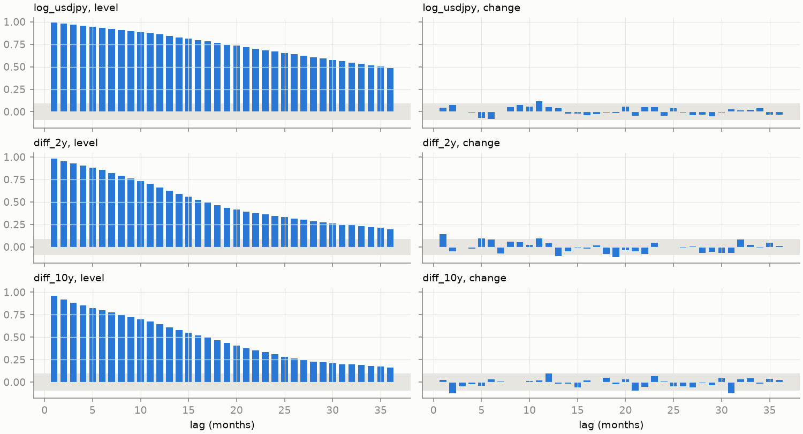
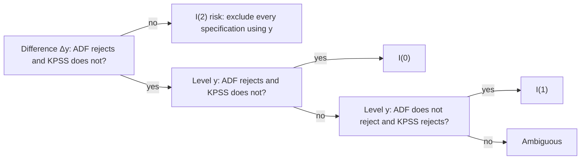

# Stationarity, unit roots and differencing

H1a works with daily <em>changes</em>; H1b asks about <em>levels</em>. That choice is
not taste. Regressing one wandering series on another can produce impressive, meaningless
results. This chapter explains what makes a series "wander", how KAGURA tested for it, why
those tests are weaker than they look, and what differencing buys and costs.

Chapter 3
Beginner → intermediate
Used in ADR 0004, H1b Stage 1

!!! abstract "What you will be able to do"
    1. Define weak stationarity and check it for an AR(1) process, deriving its mean,
       variance and autocorrelations.
    2. Explain why a random walk is not stationary and why its first difference is.
    3. Use the vocabulary I(0), I(1), I(2), and say what "unit root" means.
    4. Explain spurious regression and why it rules out naive levels regressions.
    5. Set up the ADF and KPSS tests, read them together, and apply ADR 0008's
       classification rule.
    6. Reproduce and critique KAGURA's integration-order results.

**Prerequisites.** [Chapter 2](regression-coefficients.md) (OLS, variance). Expectation
\(E[\cdot]\) is introduced in §2.

---

## 1. Intuition: does a series have a home?

Look at USD/JPY's log level since 1981 and at its month-to-month change.

Log USD/JPY: level and monthly change

Top: s relative to January 1981, in log-points. Bottom: the monthly change Δs.

Source: KAGURA frozen vintage, month-end s = 100·ln(USD/JPY), 1981-01 to 2026-07
(kagura.longrun.load_monthly).

The level drifts for decades without returning to any particular value. The change
jumps around zero, with similar-looking swings in 1985 and 2025. Informally, the change
has a "home" (zero) and a typical size; the level does not. **Stationarity** makes that
idea precise.

## 2. Tools: expectation, variance, autocovariance

Think of each observation \(y_t\) as one draw from a random variable.

| Notation | Meaning |
|---|---|
| \(E[y_t]\) | expectation: the average of \(y_t\) over many hypothetical re-runs of history |
| \(\operatorname{Var}(y_t) = E[(y_t - E y_t)^2]\) | spread around that average |
| \(\gamma_k = \operatorname{Cov}(y_t, y_{t-k})\) | autocovariance at lag \(k\) |
| \(\rho_k = \gamma_k/\gamma_0\) | autocorrelation at lag \(k\) |
| \(\varepsilon_t\) | white noise: mean 0, variance \(\sigma^2\), uncorrelated over time |

Rules used below: \(E[a + bX] = a + bE[X]\); \(\operatorname{Var}(a + bX) =
b^2\operatorname{Var}(X)\); and for uncorrelated \(X, Y\), \(\operatorname{Var}(X+Y) =
\operatorname{Var}(X) + \operatorname{Var}(Y)\).

**Weak stationarity.** A series is (weakly) stationary if

1. \(E[y_t] = \mu\), the same for every \(t\);
2. \(\operatorname{Var}(y_t) = \gamma_0 < \infty\), the same for every \(t\);
3. \(\operatorname{Cov}(y_t, y_{t-k}) = \gamma_k\) depends only on the gap \(k\), not on \(t\).

Why it matters: statistics such as sample means, correlations and regression slopes
estimate stable population quantities only if those quantities exist and do not change
over time.

## 3. The AR(1) process

The simplest model of persistence:

$$
y_t = c + \phi\,y_{t-1} + \varepsilon_t .
$$

| Symbol | Meaning |
|---|---|
| \(\phi\) | persistence: how much of last period's value carries over |
| \(c\) | constant |
| \(\varepsilon_t\) | new shock in period \(t\), uncorrelated with \(y_{t-1}\) |

### 3.1 Mean (assuming stationarity)

Take expectations of both sides: \(E[y_t] = c + \phi E[y_{t-1}]\). If the series is
stationary, \(E[y_t] = E[y_{t-1}] = \mu\), so

$$
\mu = c + \phi\mu \quad\Longrightarrow\quad \mu(1 - \phi) = c \quad\Longrightarrow\quad \mu = \frac{c}{1-\phi} .
$$

This only makes sense if \(\phi \ne 1\).

### 3.2 Variance

Because \(\varepsilon_t\) is uncorrelated with \(y_{t-1}\),
\(\operatorname{Var}(y_t) = \phi^2\operatorname{Var}(y_{t-1}) + \sigma^2\). Under
stationarity both variances equal \(\gamma_0\):

$$
\gamma_0 = \phi^2\gamma_0 + \sigma^2 \quad\Longrightarrow\quad \gamma_0 = \frac{\sigma^2}{1-\phi^2} .
$$

A variance must be positive and finite, which requires \(\phi^2 < 1\), i.e.
\(\lvert\phi\rvert < 1\). **That is the stationarity condition for an AR(1).**

### 3.3 Autocorrelations and memory

Write the process in deviations, \(\tilde y_t = y_t - \mu\), so \(\tilde y_t = \phi\tilde
y_{t-1} + \varepsilon_t\). Multiply both sides by \(\tilde y_{t-k}\) and take expectations;
the shock is uncorrelated with the past, so \(\gamma_k = \phi\gamma_{k-1}\). Repeating,

$$
\gamma_k = \phi^k\gamma_0, \qquad \rho_k = \phi^k .
$$

Autocorrelations decay geometrically. A shock's influence after \(h\) periods is
\(\phi^h\) of its initial size.

### 3.4 Half-life

The **half-life** is the \(h\) at which half of a shock remains: \(\phi^h = 0.5\). Take
logs:

$$
h\ln\phi = \ln 0.5 \quad\Longrightarrow\quad h = \frac{\ln 0.5}{\ln \phi} .
$$

| \(\phi\) (monthly) | 0.5 | 0.9 | 0.95 | 0.98 | 0.99 |
|---|---:|---:|---:|---:|---:|
| half-life (months) | 1.0 | 6.6 | 13.5 | 34.3 | 69.0 |

Near \(\phi = 1\), small differences in \(\phi\) mean very different half-lives. That is
why H1b treats half-life estimates as "descriptive only": they are weakly identified when
persistence is high ([concept: half-life](../concepts/time-series.md#half-life)).

## 4. The random walk: a unit root

Set \(\phi = 1\) and \(c = 0\): \(y_t = y_{t-1} + \varepsilon_t\). Substituting backwards,

$$
y_t = y_0 + \varepsilon_1 + \varepsilon_2 + \dots + \varepsilon_t .
$$

- **Mean:** \(E[y_t] = y_0\), constant, but meaningless as a "home": the series need never return.
- **Variance:** \(\operatorname{Var}(y_t) = t\sigma^2\). It **grows with time**, violating
  condition 2.
- **Memory:** every past shock keeps its full weight forever. Shocks are *permanent*.

With a constant, \(y_t = \mu + y_{t-1} + \varepsilon_t\) gives \(y_t = y_0 + \mu t +
\sum\varepsilon\): a **random walk with drift**, which trends and wanders. KAGURA's relative
price \(x\) behaves like this: Japanese inflation ran below US inflation for decades, so
\(x\) fell by about 92 log-points over 1981–2026.

The name **unit root** comes from writing the AR(1) with the lag operator \(L\)
(\(Ly_t = y_{t-1}\)): \((1 - \phi L)y_t = \varepsilon_t\). The polynomial \(1 - \phi z\)
has root \(z = 1/\phi\), which equals 1 exactly when \(\phi = 1\).

The same shocks, three persistence levels

Each line is driven by the identical sequence of random shocks. Only φ differs.

Illustrative: simulated with a fixed seed, not KAGURA data. Over a few
hundred periods, φ = 0.95 can look much like a random walk. This is the low-power problem of §8.

## 5. Integration order and differencing

The **first difference** is \(\Delta y_t = y_t - y_{t-1}\). For a random walk,
\(\Delta y_t = \varepsilon_t\): white noise, stationary. Differencing removed the unit root.

| Order | Definition | Example in KAGURA (pre-2022, notebook 03) |
|---|---|---|
| **I(0)** | stationary in levels | daily changes Δs, Δd |
| **I(1)** | level non-stationary; first difference stationary | s, q, x, d2, d10, r (all classified I(1)) |
| **I(2)** | must be differenced twice | ruled out for x: Δx classified I(0) |

**Why I(2) mattered in H1b.** If inflation itself had a unit root, \(x\) would be I(2), and
neither the ARDL bounds test nor FM-OLS/D-OLS would be valid (ADR 0008 §9.3). §9.2 therefore checks
the differenced series first and reports the largest autoregressive root of \(\Delta x\)
as a "near-I(2)" indicator (0.88 for \(\Delta x\), notebook 03).

**Log-differences are returns.** \(\Delta s_t = 100(\ln S_t - \ln S_{t-1})\) is both the
first difference of \(s\) and the log-point change of chapter 1. H1a's choice of changes
is a choice to work with (approximately) I(0) series.

## 6. Seeing persistence: the autocorrelation function

The sample ACF plots \(\hat\rho_k\) against \(k\). For a stationary AR(1) it decays like
\(\phi^k\); for a random walk it stays close to 1 and decays only slowly in finite samples.

<figure markdown>

<figcaption>Sample autocorrelations up to 36 months, month-end data from 1981. Left: levels
decay slowly. Right: changes are close to zero at every lag. Grey band: approximate 95 %
band for white noise. Source: reports/figures/04_acf.png (notebook 01, exploratory, ADR 0004).</figcaption>
</figure>

## 7. Spurious regression

Take two random walks that have **nothing** to do with each other and regress one on the
other. Classical OLS t-statistics assume stationary errors. Here the residual is itself a
random walk, so the standard error is far too small, and "significant" slopes appear most
of the time (Granger and Newbold, 1974; explained by Phillips, 1986).

t-statistics from regressing unrelated series

1,000 pairs of independent series of length 200. Dotted lines: ±1.96, the usual 5 % cut-offs.

Illustrative: simulated in your browser with a fixed seed. The legend reports the
share of |t| > 1.96 in each case. For white noise it should be near 5 %. For random walks it is far
higher, and it grows with T.

!!! example "KAGURA consequence (verified record, notebook 01 §6)"
    Notebook 01's note after the stationarity diagnostics: *"a regression of the FX level on
    the differential level is at risk of being spurious and is unbalanced if the differential
    is I(0) while FX is I(1). Changes are the safe baseline; any levels analysis needs a
    cointegration framework that allows for breaks."* This is why H1a uses changes and
    H1b uses cointegration methods ([concept: cointegration](../concepts/time-series.md#cointegration-and-error-correction)).

There is one exception. If a *combination* of I(1) series is stationary, they are
**cointegrated**: they share a common stochastic trend, and a levels regression is
meaningful. Establishing cointegration was exactly what H1b tried and failed to do in a
defensible way.

## 8. Testing for a unit root

### 8.1 The Dickey–Fuller idea

Subtract \(y_{t-1}\) from both sides of the AR(1):

$$
y_t - y_{t-1} = c + (\phi - 1)y_{t-1} + \varepsilon_t
\quad\Longrightarrow\quad
\Delta y_t = c + \gamma\,y_{t-1} + \varepsilon_t,\qquad \gamma = \phi - 1 .
$$

A unit root (\(\phi = 1\)) is \(\gamma = 0\); stationarity (\(\lvert\phi\rvert<1\)) is
\(\gamma < 0\). So test

$$
H_0:\ \gamma = 0\ \text{(unit root)} \qquad\text{vs}\qquad H_1:\ \gamma < 0\ \text{(stationary)} .
$$

The statistic is the usual \(t = \hat\gamma/\operatorname{se}(\hat\gamma)\), **but under
\(H_0\) it does not follow a normal or t distribution**, because the regressor
\(y_{t-1}\) is itself a random walk. Its distribution (Dickey–Fuller) is shifted left. With
a constant, the asymptotic 5 % critical value is about **−2.86**, not −1.645. (The same −2.86
appears as the I(0) bound of the PSS t-test in the [H1b report](../reports/02-h1b-long-run-fundamentals.md).)

### 8.2 The augmented test (ADF)

Real series have richer short-run dynamics than an AR(1). Adding lagged differences soaks
them up, so the error is closer to white noise:

$$
\Delta y_t = c + [\delta t] + \gamma y_{t-1} + \sum_{i=1}^{p} a_i\,\Delta y_{t-i} + e_t .
$$

| Element | Choice in KAGURA (ADR 0004; ADR 0008 §9.2) |
|---|---|
| constant \(c\) | always |
| trend \(\delta t\) | for trending series in levels: x, tax-adjusted x and q |
| lags \(p\) | chosen by AIC, at most 12 |
| p-values | MacKinnon approximations |

### 8.3 KPSS: the reverse null

The ADF null is "unit root". Failing to reject is weak evidence, because the test has low
power. The KPSS test reverses the roles:

$$
y_t = \xi t + r_t + u_t,\qquad r_t = r_{t-1} + v_t,\qquad H_0:\ \operatorname{Var}(v_t) = 0 .
$$

Under \(H_0\) the random-walk component is constant, so \(y\) is stationary around a level
(or trend). The statistic grows with the partial sums of the residuals, which wander if a
unit root is present.

### 8.4 Reading them together

| ADF (H0: unit root) | KPSS (H0: stationary) | Reading |
|---|---|---|
| does not reject | rejects | unit root likely → **I(1)** if the difference is I(0) |
| rejects | does not reject | stationary likely → **I(0)** |
| both reject, or neither | | **ambiguous** |

ADR 0008 §9.2 turns this into a rule, adding a check that the differenced series is I(0)
(else "I(2) risk"). The 5 % level is a descriptive reference, not a formal decision.

## 9. What KAGURA found

**Exploration (notebook 01, full sample from 1981, month-end; ADR 0004).**

| Series | Form | ADF stat | ADF p | KPSS p | Reading |
|---|---|---:|---:|---:|---|
| log USD/JPY | level | −2.32 | 0.166 | < 0.01 | unit root likely |
| log USD/JPY | change | −14.94 | 0.000 | > 0.10 | stationary |
| 2Y differential | level | −2.84 | 0.053 | 0.013 | borderline: both near 5 % |
| 2Y differential | change | −20.37 | 0.000 | > 0.10 | stationary |
| 10Y differential | level | −2.88 | 0.047 | 0.019 | both reject → inconclusive |
| 10Y differential | change | −17.28 | 0.000 | > 0.10 | stationary |

**H1b Stage 1 (notebook 03, pre-period 1981-01 to 2021-12; ADR 0008 §9.2).**

| Series | ADF p (level) | KPSS p (level) | Class, 1981–2021 | 1990–2021 | Including 2022–26 |
|---|---:|---:|---|---|---|
| s | 0.276 | 0.01 | I(1) | I(1) | I(1) |
| q | 0.643 | 0.01 | I(1) | **ambiguous** | I(1) |
| x | 0.334 | 0.01 | I(1) | I(1) | I(1) |
| x (tax-adj.) | 0.420 | 0.01 | I(1) | I(1) | I(1) |
| d2 | 0.069 | 0.01 | I(1) | **ambiguous** | **ambiguous** |
| d10 | 0.110 | 0.01 | I(1) | I(1) | **ambiguous** |
| r | 0.301 | 0.01 | I(1) | I(1) | **I(0)** |

KPSS p-values are bounded at 0.01 by the lookup table, so "0.01" means "≤ 0.01".
Every difference was classified I(0), so there is no I(2) risk. The last column includes
window data and "never feeds §9.3" (ADR 0008 §9.2).

**How to read this.** Over the primary sample, everything looks I(1), which made all
three H1b estimators applicable. But the classification of the real exchange rate and the
2Y differential flips with the sample start. Those are the series closest to the
boundary, and that boundary behaviour is itself informative: "I(1)" here means "the tests
could not establish mean reversion", not "proven random walk".

## 10. Why these tests are weaker than they look

1. **Low power near a unit root.** With \(\phi = 0.98\) monthly (half-life 34 months), 492
   observations contain only a handful of half-lives. ADF often cannot tell this apart from
   \(\phi = 1\) (see the simulation in §4).
2. **Breaks mimic unit roots.** A one-time shift in the mean (for example around the 1985
   Plaza Accord) makes a stationary series look non-stationary (Perron, 1989). ADR 0004
   lists this risk next to the results.
3. **The tests disagree at the margin.** Both rejecting at once (the 10Y differential in
   notebook 01) is common for very persistent series.
4. **Lag choice matters.** Too few lags leave serial correlation that distorts the size;
   too many cost power.
5. **The answer depends on the sample** (the table above).

KAGURA's response: label results descriptive, report sensitivity samples, and do not let a
unit-root test "choose the specification alone" (ADR 0004).

## 11. Differencing: what it buys and what it costs

| | Work in changes (H1a) | Work in levels (H1b) |
|---|---|---|
| Statistical safety | standard inference valid (I(0) series) | needs cointegration methods |
| Question answered | do day-to-day moves still go together? | do the series share a long-run anchor? |
| What is lost | information about long-run levels | robustness: spurious-regression risk |
| KAGURA outcome | inconclusive | not assessable / no defensible baseline |

Differencing is not a free fix. If two series are cointegrated, a regression in changes
alone ignores their tendency to return to equilibrium. That is the gap the
[error-correction model](../concepts/time-series.md#cointegration-and-error-correction) fills.

## 12. Where KAGURA uses this

| Concept | Where | Read more |
|---|---|---|
| Stationarity diagnostics | ADR 0004; notebook 01 §6 | [Concept: stationarity and unit roots](../concepts/time-series.md#stationarity-and-unit-roots) |
| Classification rule | ADR 0008 §9.2; `kagura.longrun.classify` | [Cheatsheet: time series](../cheatsheets/time-series.md) |
| Spurious regression | why H1a uses changes | [Concept: spurious regression](../concepts/time-series.md#spurious-regression) |
| Estimator applicability | ADR 0008 §9.3 | [H1b report §3](../reports/02-h1b-long-run-fundamentals.md) |
| Half-life | H1b Stage 1 (26–144 months, descriptive) | [Concept: half-life](../concepts/time-series.md#half-life) |

## 13. Common mistakes

1. **"ADF did not reject, so the series has a unit root."** Non-rejection is absence of
   evidence, especially with low power.
2. **Using normal critical values for the ADF t-statistic.** The null distribution is
   Dickey–Fuller.
3. **Forgetting the trend term** for trending series, which biases toward finding a unit root.
4. **Treating integration order as a fixed property** of an economic variable rather than
   a sample-dependent statistical description.
5. **Differencing everything by reflex.** It answers a different question.
6. **Assuming q = s − x inherits I(1) from its parts.** Each transformed series needs its
   own classification (ADR 0008 §9.3).

## 14. Defending it in an interview

> *"Your real exchange rate is I(1). Doesn't that reject PPP?"*
> Our tests over 1981–2021 could not establish mean reversion in q, and starting in 1990 the
> classification becomes ambiguous. Unit-root tests have low power when half-lives are
> several years, and breaks can mimic unit roots. So it is consistent with very slow or
> absent mean reversion; it doesn't reject PPP decisively.

> *"Why not just regress USD/JPY on the differential in levels?"*
> Both look I(1). Without cointegration that regression is spurious: t-statistics are
> invalid and R² is misleading. H1a uses changes; H1b's levels question needs cointegration
> methods, and those did not find a defensible relation.

## 15. Knowledge checks

??? question "1. An AR(1) has φ = 0.9 and σ² = 1. What are its variance and lag-3 autocorrelation?"
    \(\gamma_0 = 1/(1 - 0.81) = 5.26\). \(\rho_3 = 0.9^3 = 0.729\).

??? question "2. Why is Δs stationary if s is a random walk with drift?"
    \(\Delta s_t = \mu + \varepsilon_t\): constant mean \(\mu\), constant variance
    \(\sigma^2\), zero autocovariance at every lag ≥ 1.

??? question "3. ADF p = 0.03 and KPSS p = 0.02 for a level series. What does ADR 0008's rule say?"
    Both tests reject, so the series is **ambiguous**. ADF suggests stationarity; KPSS
    suggests non-stationarity.

## 16. Practice problems

1. Derive the mean of \(y_t = 2 + 0.6y_{t-1} + \varepsilon_t\) and its half-life.
2. Show that \(\operatorname{Var}(y_t) = t\sigma^2\) for a random walk starting at a fixed \(y_0\).
3. Write the ADF regression with one lagged difference for \(s\), and say which coefficient
   the test is about.
4. The impulse-response half-life of H1b specification (a) is 55 months with adjustment
   speed \(\phi_{EC} = -0.014\) per month. Treating the error as a simple AR(1) with
   coefficient \(1 + \phi_{EC}\), compute its half-life. Why might it differ from 55?
5. If \(x\) were I(2) and \(s\) I(1), what integration order would \(q = s - x\) have, and
   why does that matter for specification (b)?
6. Explain in two sentences why notebook 01's 10Y differential result (ADF p = 0.047, KPSS
   p = 0.019) is not evidence of stationarity.

---

## Solutions

??? success "Solutions (try the problems first)"
    1. \(\mu = 2/(1-0.6) = 5\). Half-life \(\ln 0.5/\ln 0.6 = -0.693/-0.511 = 1.36\) periods.
    2. \(y_t = y_0 + \sum_{j=1}^{t}\varepsilon_j\). The shocks are uncorrelated, so the
       variance is the sum of \(t\) variances, each \(\sigma^2\): \(t\sigma^2\).
    3. \(\Delta s_t = c + \delta t + \gamma s_{t-1} + a_1\Delta s_{t-1} + e_t\) (the trend
       \(\delta t\) only if s is treated as trending; KAGURA used a constant only for s).
       The test is about \(\gamma\): \(H_0: \gamma = 0\).
    4. \(\ln 0.5/\ln 0.986 = -0.693/-0.0141 = 49.2\) months. The impulse-response half-life
       of an ARDL with 12 lags of \(\Delta s\) includes the short-run dynamics, so it need not
       equal the AR(1) shortcut. Both are point estimates with wide uncertainty.
    5. I(2): \(\Delta q = \Delta s - \Delta x\) is the difference of an I(0) and an I(1)
       series, so it is I(1), and \(q\) is I(2). Imposing \(\theta = 1\) does not remove I(2)
       behaviour, which is why ADR 0008 §9.3 requires q's *own* classification before (b) runs.
    6. ADF rejects the unit root while KPSS rejects stationarity, so the two disagree. This
       pattern is typical of a highly persistent series or one with a mean shift, and the
       rule classifies it as ambiguous.

## Sources

- [ADR 0004](../../decisions/0004-h1-exploratory-specification.md) (stationarity diagnostics, risks);
  [ADR 0008](../../decisions/0008-h1b-long-run-protocol.md) §9.2–§9.3.
- `notebooks/01_exploration.ipynb` §6; `notebooks/03_h1b_exploratory.ipynb` §9.2–§9.3.
- Code: `kagura.explore.stationarity`, `kagura.longrun.classify`.
- References: Dickey and Fuller (1979); Granger and Newbold (1974); Phillips (1986);
  Kwiatkowski, Phillips, Schmidt and Shin (1992); Perron (1989).
